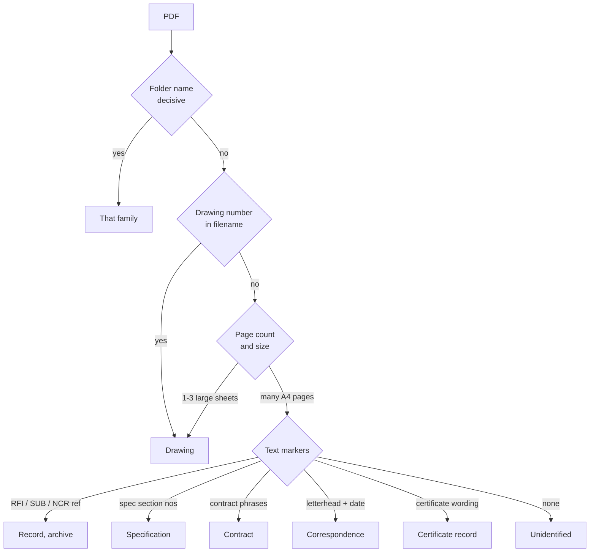
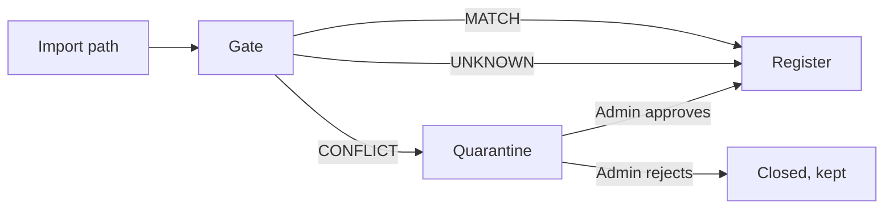
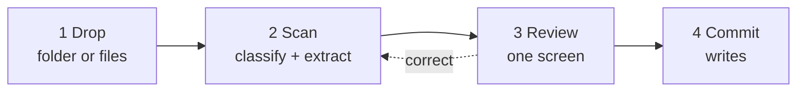
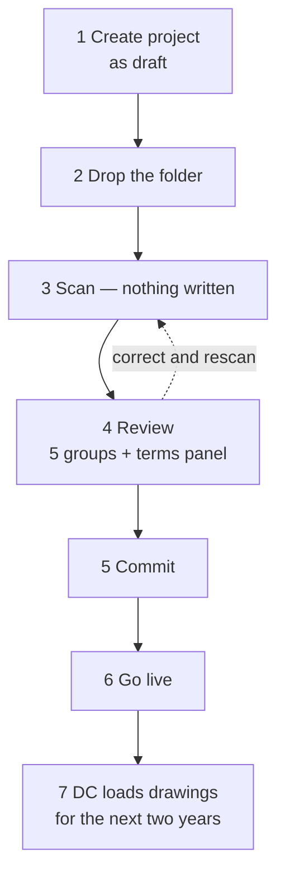
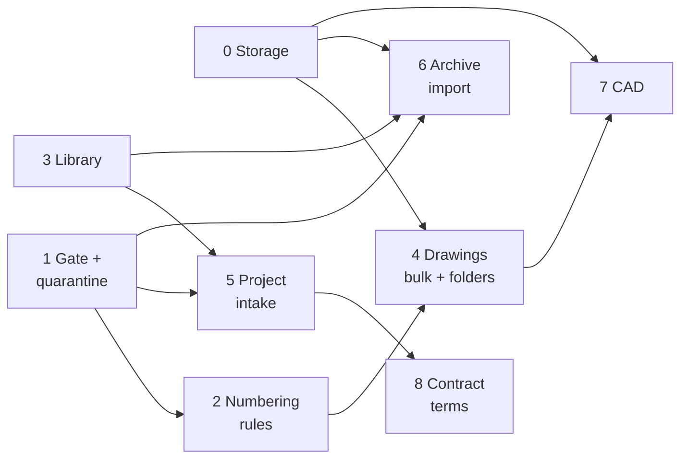

# AETRAA Extraction & Filing Engine — Specification

Sep 23, 2026 · @Someone

## 1. Purpose

The engine turns a folder of project documents into a correctly set-up, correctly filed project — and refuses to do it quietly when it is not sure.

It exists to do two jobs that pull against each other on purpose.

**Remove the retyping.** Today a contractor hands over a folder and somebody re-enters it by hand: six contract figures typed into a form, a programme picked from a file dialog, a BOQ mapped column by column, and drawings uploaded one at a time. The last of those is the job nobody finishes, which is why drawing registers rot.

**Be the gate.** Every document entering a project passes one checkpoint. Anything that does not match the project — a foreign numbering scheme, another project's reference, a figure it cannot evidence — is held, not filed, until the AETRAA Admin approves it. This is the same engine rather than a separate control, because a gate that can be bypassed by using a different importer is not a gate.

### What it is not

- **Not a document management system.** It files documents into registers that already exist. It is not a general store, and it does not become the place people keep things.
- **Not a take-off or measurement engine.** It reads what a document says. It does not measure quantities off drawings.
- **Not a contract adviser.** It proposes figures with the clause each came from. It does not interpret, and where General and Particular Conditions conflict it surfaces both and asks rather than choosing.
- **Not an approval workflow.** Filing a document does not approve it. A drawing filed by the engine still enters the register at whatever status the register's own rules give it.

## 2. Principles

Every decision later in this document follows from these six. Where a later section seems to contradict one, the principle wins and the section is wrong.

**P1 — The engine proposes; a person commits.** Nothing is written to a project on the engine's own authority. This already governs the programme import (*"Nothing is saved until you review what it found"*) and `src/ai.js` (*"This file never decides anything"*). The engine inherits that rather than inventing it.

**P2 — One gate, not one per importer.** The match test lives in a single module that every import path calls. A new importer added in two years cannot forget it, because it cannot write without passing through it.

**P3 — Zero silent errors beats high automation.** An engine that files 70% correctly and clearly flags the rest is a success. One that files 95% and quietly gets the retention percentage wrong is a failure, because nobody finds out until a payment certificate is disputed. Automation rate is the second question, never the first.

**P4 — Every proposal carries its evidence.** A proposed figure names the file, the page and the sentence it came from. A proposed drawing row names the rule that matched. A person approving must be able to check in seconds rather than trust.

**P5 — Hold for a reason, never by default.** A hold requires positive evidence of a mismatch. The engine does not hold a document because it is merely unsure; it files what matches and holds only what conflicts. A gate that stops honest work twice is a gate the Document Controller stops using — and losing the register costs more than the freeloading it prevented.

**P6 — Nothing is lost.** A held document is uploaded, visible and named to the person who sent it, with the reason. It is withheld from the register, not from the person. Work never disappears because the engine was unsure.

### The consequence to accept

These principles mean the engine will always be slower to finish than a system that simply imports everything. That is the trade being made deliberately: the platform's value rests on figures a contractor can stand behind in a dispute, and an engine that can silently corrupt those figures destroys more value than it creates.

## 3. The document inventory

**Every file in the folder gets a destination.** Not a chosen few. A file the engine cannot place is listed for a person to place, never left out and never silently dropped.

This runs for the life of the project, not only at onboarding — documents arrive for two years after setup (§8).

### The fourteen families

| Family | Formats seen in practice | Destination | Phase |
| --- | --- | --- | --- |
| Drawings — tender, IFC, shop, as-built, sketch | PDF, DWG, DXF | Drawing register | 4 |
| Specifications | PDF, **DOCX** | Library (`specification`); drawing register (`spec`) where sheet-sized | 4 |
| Contract — agreement, conditions, addenda, bonds, insurance | PDF, **DOC, DOCX** | Library + the seven terms proposed | 8 |
| Programme | `.xer` | Programme | 5 |
| Commercial — BOQ, BOM, rate build-ups | **XLSX, XLS, CSV**, PDF | BOQ / BOM tables | 5 |
| Payment — applications, certificates | PDF, **XLSX** | Library (`payment`), linked to the IPC register by number | 6 |
| Technical — submittals, material approvals, method statements, RFIs | PDF, **DOC, DOCX** | Records, as archive | 6 |
| Quality — ITPs, inspections, NCRs, test and mill certificates | PDF, **XLSX, DOCX** | Records, as archive | 6 |
| HSE — permits, incidents, training, plant and operator certificates | PDF, **XLSX, DOCX** | Records, as archive | 6 |
| Authority — NOCs, applications, approvals | PDF | Authority register | 6 |
| Correspondence — letters in and out | PDF, **DOC, DOCX**, MSG, EML | Records (`letter` / `incoming`), as archive | 6 |
| Transmittals and meeting minutes | PDF, **DOCX** | Minutes store where readable, else library (`report`) | 6 |
| Site — diaries, survey records, progress photos | PDF, **XLSX**, JPG | Library (`report`); photos `photo` | 6 |
| Handover — O&M manuals, warranties, T&C records | PDF, **DOCX, XLSX** | Library (`o_and_m` / `warranty`) | 3 |
| **Templates — blank consultant forms** | **DOCX, XLSX, PDF** | Template store | 5 |

Phase numbers are §16's. **As-built drawings are drawings** and belong to the first row, not to Handover (§6). `.mpp` is not read in v1 — a Microsoft Project file is listed as unidentified, because no importer exists for it.

### The missing destination: a project library

The platform today has four places a document can land — the drawing register, a record in the workflow engine, an attachment hanging off a record, and the template store. **There is nowhere for a document that is none of those.**

A contract, a performance bond, an insurance policy, an O&M manual, a warranty, a standalone specification, a survey report: all real, all needed, none of them a drawing or a workflow record.

So the engine needs a **project library**: a filed document with a family, a title, a date, a reference, the file itself, and optional links to whatever it relates to. No workflow, no approval ladder — a filing cabinet that is searchable and exportable.

Without it, "every file gets a destination" cannot be true, and the engine would quietly fall back to leaving documents out.

### Existing documents from a live project — filed as archive, never as live records

A contractor joining mid-job has two years of RFIs, submittals and letters already raised elsewhere. They must be filed and searchable. They must **not** become live workflow records.

An imported RFI marked as awaiting a consultant reply starts a reply-by clock that never ran, and shows an overdue position that is not real. Build a time-bar argument on that and it collapses the first time the other side checks the dates.

**So an imported record is created closed, marked `imported`, with:**

- its document, reference, date and subject, fully searchable and exportable
- no pending step, no owner, no reply-by clock, no overdue flag
- a visible marker on screen and in every export: *imported — not raised on this platform*
- its real dates preserved as recorded facts, never as computed deadlines

New records raised after go-live behave normally. The line between imported history and live workflow is explicit, and is the difference between a useful archive and a liability.

### The seven contract terms

The only values read from the contract, because they are the only ones the platform computes from. Called \*\*the seven terms\*\* throughout:

1. Retention percentage
2. Retention cap (percentage of contract value)
3. Advance payment percentage
4. Payment period, in days
5. Notice clause reference (e.g. Sub-Clause 20.2.1)
6. Contract completion date

7) RFI reply period in days, where the contract states one — it populates `projects.reply_days`

Seven terms, treated identically wherever this document refers to them. The rest of the contract is filed in the library and read by people, not by the engine.

### The rule that replaces the old exclusions

> Every file is filed somewhere. A file the engine cannot classify is **listed for a person**, with its name, size and folder. Nothing is dropped, and nothing is filed on a guess.

## 4. Classification

The first real task is not extraction — it is working out what each file is. A contractor's folder holds four hundred files, many named `Scan_0012.pdf`.

**PDF is the hard case and the common one.** A drawing, a specification, a contract, an RFI, a test certificate, a bond and an O&M manual are all PDFs. Extension tells you almost nothing, so PDF gets its own cascade.

### The top level

| Extension | Goes to |
| --- | --- |
| `.xer` | Programme |
| `.mpp` | Unidentified — no importer exists (§3) |
| `.xlsx`, `.xlsm`, `.xls`, `.csv` | **The spreadsheet cascade** below |
| `.docx`, `.doc`, `.rtf` | **The Word cascade** below |
| `.dwg`, `.dxf` | CAD (§6) |
| `.jpg`, `.jpeg`, `.heic` | Logo by filename; site photo by folder; else unidentified |
| `.png` | Logo by filename; else unidentified — **no EXIF date is available** |
| `.msg`, `.eml` | Correspondence |
| `.zip` | Expanded under limits (§19), contents classified individually |
| `.pdf` | **The PDF cascade** below |

### The spreadsheet cascade

A spreadsheet is not only a BOQ. A contractor's folder holds snag lists, manpower histograms, cashflows, risk registers, document registers, testing schedules and blank inspection forms — all `.xlsx`.

The first worksheet's header row decides, in this order:

| Header contains | Becomes |
| --- | --- |
| Rate **and** Amount (or Section + Qty + Rate) | Priced BOQ |
| Budget Qty, or Budget + Material | BOM |
| Placeholder tokens in cells, and no data rows | **Template** |
| Ref + Description + Status, many rows | Snag or defect list → library (`report`) |
| Date columns across, counts down | Histogram or programme print → library (`report`) |
| Certificate or test wording | Quality record → archive |
| None of these | Unidentified |

**`.xlsm` is read for data, never for macros** (§19). **`.xls`** — the pre-2007 binary format — is still common from older consultants; where it cannot be read it is filed to the library unread rather than dropped.

**A workbook with several sheets is judged on the first sheet that has a usable header row**, and the sheet that decided is recorded. A BOQ split across per-trade tabs is the normal case, not the exception.

### The Word cascade

Word files are just as varied: contracts, method statements, letters, spec sections, minutes, reports and blank forms.

In order:

| Test | Becomes |
| --- | --- |
| Placeholder tokens present (`{{ }}` or `<< >>`) | **Template** |
| Contract phrases — *retention*, *sub-clause*, *time for completion* | Contract |
| Letterhead block + date + subject | Correspondence |
| Spec section numbering | Specification |
| Method statement or ITP wording | Technical record → archive |
| Meeting heading + attendee list | Minutes |
| None of these | Unidentified |

**`.doc` and `.rtf`** are legacy formats the platform cannot parse today. They are **filed to the library unread, marked *not read — legacy format*** — never dropped, and never guessed from the filename alone (§6).

### Templates can be any format

A consultant's blank form is a `.docx` on most jobs, an `.xlsx` on many (inspection checklists, testing schedules), and a `.pdf` on some.

**Template detection is by content, not extension:** a file carrying placeholder tokens and no data is a template, whatever it is. A blank form with no tokens is still a template if it sits in a folder that says so — it is filed as one and listed as *no placeholders found*, because a form nobody can fill automatically is still the form that must be used.

The template store today accepts **`.docx` only**, with twelve document types and a 5 MB limit. Accepting `.xlsx` and `.pdf` templates is a change to that store, specified in §6, and it is a prerequisite for the Templates row in §3.

### The PDF cascade

Tests run in order; the first that matches wins, and the test that matched is recorded as the reason.



**Folder name first — when there is one worth reading.** A tidy tree already encodes the answer — `/04 Submittals/`, `/Test Certificates/`, `/IFC Drawings/Structural/`. When it is there it is the cheapest signal in the engine, and the reason §8 keeps the folder path rather than flattening the list.

**But a tidy tree is the lucky case, not the normal one.** Real folders arrive flat — four hundred files in one directory, named `Scan_0012.pdf` and `New folder (3)`. Folders named after people, or dates, or nothing. Two different things in one folder. The same drawing in three folders.

So the folder name is a **hint that is used when it is decisive and ignored when it is not**. A folder called `04 Submittals` decides; one called `Ahmed` or `New folder` contributes nothing and the next test runs. **The engine must work on a flat dump of four hundred files**, and every test after this one is written on that assumption. A folder tree makes it better; its absence never makes it fail.

**Page geometry second.** A drawing is one to three pages at A1 or A0. A specification is hundreds of A4 pages. A certificate is one or two A4 pages. This separates the three biggest families before any text is read.

**Text markers third.** A reference matching `RFI-0042`, `SUB-118`, `NCR-07` places a document as an archived record of that type and carries its reference across. Specification section numbers, contract phrases, a letterhead with a date, certificate wording: each is a marker with a named pattern.

**Scanned PDFs carry no text.** Where geometry says drawing, it is treated as a drawing without OCR. Otherwise it is unidentified, and the folder name usually rescues it. OCR is not in v1 (§5).

### Unidentified files

An unidentified file is **listed, never discarded and never guessed at**. It appears under *Not identified* with its name, size and folder, and the person says what it is or leaves it out.

Two hundred unidentified files is a signal that the folder tree is unusual and the project's rules need configuring — not a failure to hide.

### Learning a contractor's folder tree

A contractor uses the same tree on every project. When the person places twenty files from `/05 MAR/` as material approvals, the engine offers to remember that mapping for this company. The second project onboards far more cleanly than the first.

The mapping is per company, proposed and never silent, and visible and editable in setup.

### Why not simply ask a model

A model could read each PDF and say what it is, and that will be tempting where the cascade fails.

**The rule: a model may propose a classification the deterministic tests could not place, and may never override one they did place.** The deterministic path stays the spine — it behaves identically on Tuesday and on Friday, it can be tested, and it costs nothing per file. On four hundred files a model pass is also slow and expensive, which matters when a Document Controller is waiting.

## 5. The project fingerprint and the match test

This is the heart of the gate, and the section most likely to be got wrong. "Does this document belong to this project?" has no clean answer for most file types, and pretending otherwise produces either false holds or a gate that catches nothing.

### The fingerprint

Set by the AETRAA Admin at project setup. The reference, name and party names already exist on the `projects` row; the numbering scheme, the aliases and the plot or contract number are new (§10).

| Element | Source | Strength as evidence |
| --- | --- | --- |
| Drawing numbering scheme | New — set at setup | Strong |
| Project reference | `projects.ref` | Strong where a document states one |
| Project name and aliases | `projects.name` + aliases | Weak — names are written many ways |
| Client, consultant, contractor | `projects.client_name` etc. | Weak — same parties across projects |
| Plot or contract number | New, optional | Strong where present |

The numbering scheme is the only new configuration. `src/drawing-classify.js` already carries the engine and 38 passing checks, and its own comment anticipates this: *"THESE ARE DEFAULTS — every project overrides them, because one office's 'S-' is another's 'ST-'."* Nothing stores those overrides today.

### The three verdicts

Every document gets exactly one.

**MATCH — file it.** Positive agreement with the fingerprint. A drawing whose number prefix matches a configured rule. A spreadsheet whose header row is recognised and whose project reference cell, if present, agrees.

**UNKNOWN — file it, and say so.** No evidence either way. A template with no project identity anywhere in it. A drawing on a project whose numbering scheme has not been configured. These are **filed**, because holding everything the engine cannot prove would hold almost everything (P5). They are listed in the review screen as filed-without-verification, so the person sees what was taken on trust.

**CONFLICT — hold it.** Positive evidence of mismatch. A drawing numbered under a scheme configured for a *different* project on this platform. A document stating a project reference that is not this one. A BOQ whose header names another project.

### The definition that matters

> A document is held when the engine can point at the reason. It is never held merely because the engine is unsure.

That asymmetry is deliberate and is the difference between a gate people tolerate and one they route around. UNKNOWN is the common case and must stay cheap.

### The one strong signal, and its cost

The numbering scheme is the only test that reliably catches another project's drawings, because another project's drawings genuinely are numbered differently. It only works if the scheme is configured — which means the AETRAA Admin must set it at onboarding, from the drawing register the contractor supplies.

**Consequence to accept:** on a project where nobody configured the scheme, the drawing gate does nothing. That is honest and should be visible — the project's setup screen should say *drawing gate: not configured* rather than implying protection that is not there.

### What is explicitly not attempted in v1

**Reading the title block.** Extracting the project name from inside a drawing sheet would be the strongest test of all. It needs OCR on scanned sheets, it is brittle across drawing offices, and a false positive holds legitimate work. Revisit once the numbering gate has run on real projects and the false-hold rate is known.

## 6. Extraction rules per document type

Each type declares three things: what is read, by what method, and what happens when reading fails. "Fails" never means "guesses".

### Drawings

**Read:** number, revision, title, discipline, trade group, kind, floor. **Method:** `fromFileName()` for number/revision/title; `classify()` against the project's rules for discipline; the existing KIND\_HINTS for tender / IFC / shop / spec / sketch; the containing sub-folder name as a secondary discipline hint. **Fails to:** unsorted. Listed with its filename for a person to place. Never filed to a guessed discipline — a drawing in the wrong discipline is built from. One change to the existing classifier is required: `classify()` currently sets `kind = 'shop'` before testing the hints, so a sheet matching none is filed as a shop drawing by default. That is a guess, and this engine does not guess — the default must become blank, and an unmatched kind listed for a person.

A drawing whose number already exists on the project is a **revision**, not a duplicate, and follows the register's existing revision rules: it does not supersede the current sheet until approved. The engine never approves.

### Programme

**Read:** delegated whole to the existing `.xer` importer. **Method:** unchanged. The engine's only additions are finding the file and routing it. **Fails to:** the importer's own error, surfaced.

One `.xer` per project. Two in a folder is a CONFLICT the person resolves by choosing, because a programme silently replacing a baseline destroys every delay position computed from it.

### Priced BOQ and BOM

**Read:** the columns already recognised — Section, Ref, Description, Unit, Qty, Rate, Amount, Billed%; and Ref, Material, Unit, Budget Qty, Rate, Amount. **Method:** header-row mapping, as today. The engine proposes the mapping; the person confirms it. **Fails to:** the mapping screen, with the unmapped columns named.

Re-import rules are the existing ones. A BOM re-import updates budgets and keeps what site has already ordered and received.

### Templates

**Read:** document type, the format, and the placeholder tokens present. **Method:** content first — a file carrying `{{token}}` or `<<token>>` and no data rows is a template whatever its extension. Folder and filename keywords (*rfi*, *submittal*, *transmittal*, *inspection*) give the document type. **Fails to:** uploaded, type unset. The person picks from the existing list of twelve.

#### Formats

| Format | Today | Needed |
| --- | --- | --- |
| `.docx` | **Supported** — tokens read from every text-carrying part | — |
| `.xlsx` | Not supported | Token scan across cells, headers and footers |
| `.pdf` | Not supported | Stored as the issued form; no token filling |
| `.doc`, `.rtf` | Not supported | Out of scope — ask the consultant for `.docx` |

The store is hard-coded to `.docx` today: the key is written as `…/<id>.docx` and the token reader rejects anything without `word/document.xml`. **Accepting `.xlsx` and `.pdf` is a change to `templates-store.js`, not a setting**, and it is a prerequisite for the Templates row in §3.

**An `.xlsx` template matters more than it sounds.** Inspection checklists, testing schedules and daily report forms are almost always Excel on a UAE job, and they are exactly the documents issued most often.

**A `.pdf` template cannot be filled.** It is stored so the issued document carries the consultant's own artwork, with data placed by position rather than by token — or, where that is not possible, kept as the reference form a person fills by hand. It is never silently treated as fillable.

The engine also reports **tokens a template uses that the platform does not supply** — a real error that currently surfaces only as a blank in an issued document.

### Logos

**Read:** which party the image belongs to. **Method:** filename keywords only (*client*, *consultant*, *contractor*). **Fails to:** listed as an unassigned image. Never guessed — the wrong logo on an issued document is worse than none.

### Specifications

**Read:** section number, section title, revision, division. **Method:** a spec is recognised by many A4 pages plus section numbering — CSI MasterFormat (`03 30 00`), a CESMM/POMI letter section, or a plain numbered clause tree. The number and title are read from the first page of each section and from the table of contents where one exists. **Fails to:** filed whole as one document in the library, family `specification`, with no section index. Still findable, just not indexed.

A bound specification of 600 pages is **split by section where the table of contents can be read**, so `03 30 00 Cast-in-Place Concrete` is retrievable on its own. Where it cannot, the whole document is filed unsplit rather than split on a guess — a wrongly split spec sends someone to the wrong clause, which is worse than scrolling.

The spec is also a destination for the drawing register (`kind: spec`) where it arrives as a drawing-sized sheet. Both are correct; the family follows page geometry.

### Certificates and test records

The densest family by count — a tower generates thousands.

| Document | Becomes | Key fields |
| --- | --- | --- |
| Concrete cube / cylinder result | `cert`, archive | Pour ref, date cast, date tested, age, strength, pass/fail |
| Compaction / field density | `cert`, archive | Location, layer, date, result |
| Mill certificate (rebar, steel) | `cert`, archive | Heat number, grade, supplier, batch |
| Material test report | `cert`, archive | Material, standard, lab, date |
| Plant / lifting equipment certificate | `cert` | Plant id, inspector, issue date, **expiry** |
| Operator licence | `cert` | Holder reference, category, **expiry** |
| Calibration certificate | `cert` | Instrument, lab, **expiry** |

**Expiry is the field that matters.** A plant certificate is held as a record precisely so an expiry date is something the platform can act on rather than a note in somebody's folder. Where an expiry is read, it is proposed; where it is not, the item is listed as *expiry not found* rather than filed with a blank that nobody notices.

**A failed test result is never auto-linked to an NCR.** The link between a failed cube and a non-conformance is an engineering judgement. The engine files the result and flags the failure; a person raises the NCR.

### Correspondence and minutes

**Read:** direction (in / out), reference, date, subject, from, to, and any reference it replies to. **Method:** letterhead and a date block; `Our ref` / `Your ref` patterns; a subject line; `In reply to` / `Further to` phrasing for the reply link. `.msg` and `.eml` carry these in their headers and are far more reliable than a scanned letter. **Fails to:** library, family `report`, with its date if one was read.

**Direction decides the record type:** outgoing becomes `letter`, incoming becomes `incoming`. Where direction cannot be determined, the item is **listed for a person** — never guessed, because an incoming letter carries a reply obligation and an outgoing one does not.

**Reply chains are proposed, never assumed.** Where letter B states it replies to letter A, the link is offered. Where it is inferred only from subject similarity, it is not.

**Meeting minutes** become a record in the minutes store where the existing structure can be read — meeting reference, date, attendees, items. Where it cannot, the document is filed in the library. **Actions inside imported minutes are not created as live actions**: an action with an owner and a due date, imported from a meeting eighteen months ago, appears as overdue and assigned to someone who may have left. They are filed as text within the minute.

### Authority documents

**Read:** authority, scope, reference, submission date, decision, decision date, expiry. **Method:** authority recognised by name against the existing authority list (DEWA, DCD, Dubai Municipality, RTA, Etisalat, du, Trakhees, master developers); reference by the authority's own pattern; decision by outcome wording. **Fails to:** library, family `report`.

An approval becomes an `authority` record matched to the authority item **already on the project** where one exists, rather than creating a second entry for the same NOC. Where no matching item exists, the item is listed — an NOC nobody set up is either a missing setup step or another project's document, and both are worth a person seeing.

**NOC expiry is treated like plant certificate expiry:** proposed where read, flagged where absent. An expired NOC discovered at inspection is a stoppage.

### Payment documents

**Read:** application or certificate number, period, gross, previous, net, retention, deductions, date. **Method:** the numbers are read only from a structured source — the accompanying spreadsheet, or a PDF whose table can be read cleanly. **A scanned certificate is filed as a document with no figures extracted.** **Fails to:** library, family `report`, linked to the IPC register by number.

**No figure from a payment document is ever posted to the IPC register automatically — not even as a proposal that is ticked by default.** The platform computes certificates from the BOQ and the measured progress. A historic certificate is evidence of what was paid, filed alongside; it does not become the platform's own arithmetic. Importing a past certificate as live IPC data would produce a valuation the platform cannot reproduce from its own BOQ, which is exactly the number that gets challenged.

### Site photographs

**Read:** date taken, and location where the image carries GPS. **Method:** EXIF on JPEG and HEIC only. Nothing else — no image recognition, no subject detection. **PNG carries no EXIF** in the JPEG sense, so a `.png` always takes the folder date or the file date. **Fails to:** filed with the folder date, or the file date.

Photos are filed to the library, family `photo`, and linked to an activity or record **only where the folder or filename names one** (`/Photos/ACT-118/`). A photo linked to the wrong activity is worse than one linked to nothing, because progress claims are evidenced by photographs.

**Volume warning.** Photos are the family that fills storage (§12). A drop containing more than 200 images, or more than 500 MB of them, warns before commit with the total and what it leaves.

**EXIF is stripped of personal fields** — camera owner, serial number and any embedded contact data — keeping date and coordinates.

### Handover documents

**Read:** title, system or discipline, revision, date. **Method:** filename and folder; the cover page where readable. **Fails to:** library, family `o_and_m` or `warranty`, title from the filename.

O&M manuals, as-built drawing sets, warranties, guarantees, testing and commissioning records, spare parts schedules. These arrive late, in bulk, and matter at handover and through the defects liability period.

**As-built drawings are drawings**, filed to the register with `kind: other` and marked as-built — not library documents. They supersede nothing: the IFC set stays as issued, because the as-built records what was actually built and the IFC records what was instructed.

**A warranty's start and end dates are proposed where read** and otherwise left blank. A warranty period is a date the platform could act on later; guessing it is worse than leaving it for a person.

### CAD files — DWG and DXF

**A CAD file is the source of a drawing sheet, not a register row of its own.** A register listing `ST-101.pdf` and `ST-101.dwg` as two drawings is a broken register.

So a CAD file is paired to its sheet by number and revision, and filed as that sheet's **native source**. Where no PDF exists, the CAD file becomes the sheet and is marked *no PDF issued* — a real condition worth seeing, because nothing can be issued to a consultant from a DWG.

#### DXF is readable; DWG is not

|  | DXF | DWG |
| --- | --- | --- |
| Format | Text, documented | Proprietary binary |
| Title block | **Readable** — text entities by layer | Not without a converter |
| In v1 | Number, revision, title, scale read from the title block | Stored and paired; contents not read |

This matters more than it looks: **a DXF title block is the strongest match signal in the engine.** A filename lies — people rename files. A title block is what the drawing office actually stamped. Where a DXF is present, it outranks the filename for number and revision, and a disagreement between the two is itself worth flagging.

DWG needs a converter (ODA File Converter or equivalent) with its own licensing and a process on the server. **Out of scope for v1**, and revisited only if DXF-less DWG sets prove common.

#### Three problems CAD brings that PDFs do not

**Size.** A DWG is routinely 10–200 MB against a 1.4 MB drawing limit and a 25 MB attachment limit. CAD cannot be accepted at all until files are out of the database (§12). A single CAD set can exceed the platform's entire 32 GB.

**External references.** A DWG xrefs other DWGs — grids, levels, a base plan. Stored alone it opens with holes. So CAD is filed as a **package**: the sheet files plus their xrefs, kept together, with missing xrefs listed rather than discovered months later by the person who needed them.

**Revision truth.** A CAD file dated after the PDF it is paired with means someone drew past the issued sheet. The engine reports it and does not resolve it — the issued PDF stays authoritative, because that is what was sent to the consultant.

#### What CAD is not used for in v1

**No geometry is read.** No quantities, no areas, no layer analysis, no clash detection. The engine files CAD; it does not measure it. Take-off from CAD is separate work with its own spec, and mixing the two makes a filing engine that nobody can trust.

#### The honest position

CAD support is **Phase 7, and only after object storage** (§16). Until then the engine accepts PDF drawings and lists any CAD file it finds as *recognised, not stored — exceeds the current file limit*, so nobody believes a CAD set is safely filed when it is not.

### Contract terms

The highest-risk extraction in the engine, and the one where a wrong answer is silent and expensive.

**Read:** the seven terms in §3. **Method:** two passes.

1. **Deterministic first.** Regular expressions over the extracted text for the shapes these terms take: `retention ... 10%`, `Sub-Clause 20.2.1`, `56 days`. Every hit records the page and the sentence.
2. **Model second, only where the first found nothing,** through `src/ai.js`. It returns a proposed value with a verbatim quotation and page. It is never asked to adjudicate.

**Fails to:** blank. The person types the figure, as they do today. A blank field is a correct outcome, not a failure.

#### Two rules specific to the contract

**Conflicts are surfaced, never resolved.** Where retention appears in both General and Particular Conditions, both are shown with their clauses and the person chooses. The engine does not know that Particular Conditions prevail, and must not act as if it does.

**No contract figure is ever auto-applied,** whatever the confidence — the one exception to nothing in this engine. Even a single unambiguous hit is a proposal the person confirms, because every payment certificate for the life of the job is computed from it.

## 7. The gate

One module. Every path that writes a document into a project calls it, including paths written years from now. It is the architectural equivalent of `stepPermission` — one place decides, and no caller can decline to ask.

### What it does

It takes the project, the classified item and its evidence, and returns MATCH, UNKNOWN or CONFLICT. It does not write anything. Callers must treat CONFLICT as a refusal to file, and the refusal is enforced by the importer having no other route.



### Quarantine

A held item is a row in a `quarantine` table plus its file in the normal file store. It carries the project, what the engine thought it was, the reason, the evidence, who sent it and when.

**The person who sent it sees it immediately** — in their own upload result and in a *Held* list on the project. They see the file name, the reason in plain words, and that it is with AETRAA. They are not left wondering whether the upload worked (P6).

**It is not in any register.** It does not appear in the drawing register, does not count in any total, does not reach a consultant, and is not exported to Excel.

### Who approves

**The AETRAA Admin only.** That is the point of the control: the contractor cannot approve their way past it. This is a deliberate bottleneck, and §9 sets out why it is acceptable and where it must not be allowed to spread.

Three actions:

| Action | Effect |
| --- | --- |
| **Approve** | The item is filed as if it had matched. Recorded with who approved and when. |
| **Approve and widen the rule** | Filed, **and** the project's fingerprint gains the rule that would have matched it. The same hold never recurs. |
| **Reject** | Closed with a reason. The file is kept, not deleted. The sender sees the reason. |

### Widening is the one that matters

Without it the gate is a treadmill: a contractor whose subcontractor numbers shop drawings `SUB-`, on a project configured for `ST-` and `ME-`, generates a hold on every single sheet forever.

With it, the first `SUB-101` is held, the Admin approves and widens once, and every later `SUB-` sheet files normally. **The gate should get quieter on a healthy project and stay noisy only on a project where something is genuinely wrong.** If the hold rate on a project is not falling week by week, either the rules are not being widened or something really is being smuggled — and both are worth knowing.

### Bulk actions

A folder drop can hold two hundred items at once. Approving them one at a time is not a control, it is an obstacle. The queue groups by reason — *142 drawings numbered `SUB-`* — so the Admin makes one decision per **reason**, not per file.

### The failure mode to watch

The gate's real enemy is not a determined freeloader; it is an Admin with forty items queued who approves them unread to clear the list. Two defences: keep the queue small by widening rules, and group by reason so a decision is about a pattern rather than a file. If the queue is routinely long, the design is wrong, not the Admin.

## 8. The operator flow

Four steps. Nothing is written until step four, and step four is a deliberate act.



### Step 0 — create the project as a draft

Everything attaches to a project, so the project must exist before a folder is dropped. But the contract terms are what intake is meant to read *for* you — create the project fully and you have typed the seven figures by hand before intake ever runs, which defeats it.

`projects.setup_state` already takes `draft` or `live`, so:

|  |  |
| --- | --- |
| **Create as draft** | Company, project name, reference, location, parties, modules, Principal. **Commercial terms left blank.** Thirty seconds |
| **Then drop the folder** | The terms come back as proposals with their clauses |
| **Accept them, and go live** | The project has terms with provenance, not six numbers somebody typed |

A draft project is invisible to the customer. Nobody can sign in to it, nothing can be raised on it, and it appears only in the AETRAA console. **Going live is a deliberate act** after the review, not a side effect of committing a batch.

A project can also be created live and intake run later — an existing customer adding their contract months afterwards. The terms are then proposed against the figures already set, and **a proposal that disagrees with a figure in use is flagged rather than applied**, because certificates have already been computed from it.

### The whole sequence, end to end



1. **Create the project as a draft** — AETRAA console, *Onboard a project*, terms blank.
2. **Open *Project intake*, pick it, drag the folder in.** Sub-folders and all; nothing to zip, nothing to install.
3. **It scans.** A per-file count and the current filename, never a bare spinner (§20).
4. **Review.** Five groups, plus the contract-terms panel — each term with its value, clause, sentence and page, **unticked by default**.
5. **Commit.** Programme, BOQ, BOM, templates and logos land through the importers that already exist; accepted terms populate the project; conflicts go to the held queue.
6. **Go live.** The customer's people can now sign in.
7. **Drawings continue.** The Document Controller loads them from inside the project, for the life of the job.

### 1 — Drop

A whole folder, dragged onto the page. Browsers support this natively, sub-folders and all; **no program to install, and it works from any machine.** A local agent is only worth building for a contractor with tens of gigabytes on a server that will never go through a browser, and is out of scope here.

Sub-folder names are kept — `/Tender Drawings/Structural/` is a discipline hint the flat file list would lose.

### 2 — Scan

Classification and extraction. **Nothing is written to any register.** Large files are read in the browser where possible so four hundred drawings do not pass through the server twice.

Progress is per file, and a file that fails to parse fails alone — it never aborts the batch.

### 3 — Review — the screen that matters

One screen, five groups, every item counted:

| Group | What the person does |
| --- | --- |
| **Ready to file** | Scan the summary. Nothing to decide. |
| **Filed without verification** | Note what is being taken on trust. |
| **Needs a decision** | Pick a discipline, confirm a column mapping, choose between two programmes. |
| **Will be held** | See what is going to the Admin, and why, before committing. |
| **Not identified** | Say what these are, or leave them out. |

Contract terms are **not** in those groups. They appear as their own panel: proposed value, the clause, the sentence, and the page — each with accept or edit, each unticked by default.

The summary line is the whole design in one sentence:

> 412 files · **340 ready** · 19 filed without verification · 34 need a decision · **7 will be held** · 12 not identified

### 4 — Commit

Writes what was confirmed. Held items go to quarantine. A progress list shows each item as it lands, then a result the person can keep.

Commit is **resumable, not atomic**: if it fails at item 300, the first 299 are filed and re-running the same folder picks up where it stopped (§13).

### The same flow, for the life of the project

Onboarding is the first drop, not the only one. The same four steps run every time documents arrive — a revised IFC set in month eight, a subcontractor's shop drawings, this month's test certificates, an addendum to the contract.

**Nothing about the flow changes.** What changes is scale and who runs it:

|  | First drop | Every later drop |
| --- | --- | --- |
| Who | AETRAA Admin | The project's DC, usually |
| Size | Hundreds of files | A handful to a few dozen |
| Content | Everything | One family, usually drawings |
| Mostly | New | **Revisions of what is there** |
| Review screen | Read carefully | Skimmed — so *already filed* and *revision* counts must be prominent |

That last row is the design consequence. On a later drop the interesting numbers are not *380 ready* but **"12 revisions, 3 new, 38 already filed"**. A DC who cannot see at a glance that a drop is mostly revisions will either re-file everything or stop checking. The review screen leads with what changed.

### A drop is never the whole project again

After the first, a drop is a delta. The engine never interprets a partial folder as the project's full content — a drop of 12 drawings does not imply the other 388 were withdrawn. **Nothing is ever removed, superseded or closed because it was absent from a later drop.** Superseding is the register's own act, on an approved revision.

This sounds obvious and is exactly the assumption a sync tool gets wrong. This is not a sync tool: it is an in-tray.

### Where later drops come from

A drag onto the page, as at onboarding. Two other routes are plausible later and neither is in v1: a watched cloud folder (SharePoint, Drive) with OAuth per customer, and a local agent for a contractor with tens of gigabytes on a server. Both are additions to the same pipeline, not different pipelines.

### The two screens behind it

**Held items** — the Admin's queue, grouped by reason, with approve / approve-and-widen / reject.

**What this project holds** — drawings, records, storage and last activity per project. This is where a project quietly filling with another job's work becomes visible, and it is the control that does not depend on anyone reading a queue.

## 9. Access

Two roles, and the line between them is the commercial control.

|  | AETRAA Admin | Contractor's DC / PM |
| --- | --- | --- |
| Create a project | Yes | **Never** |
| Set commercial terms, modules | Yes | No |
| Set the numbering scheme | Yes | No |
| Run project intake (contract, programme, BOQ, templates) | Yes | No |
| Bulk-load drawings into an existing project | Yes | **Yes** |
| Approve a held item | Yes | **Never** |
| See held items and reasons | Yes | Yes, their project only |

### Why the split is here and not elsewhere

**Project creation is centralised because it must be.** `/api/setup/onboard` already refuses anyone without the master code — a server refusal, not a hidden button — and the contractor's own app shows the padlock *"Projects are fixed — new projects can't be added."* That is what makes the commercial terms trustworthy: the figures certificates are computed from can only have come from AETRAA.

**Drawing loading is devolved because it must be.** Setup happens once; drawings arrive for two years. IFC supersedes tender, subcontractors send shop drawings, Rev C replaces Rev B. Routing that through AETRAA makes one person the bottleneck on every client's register — and an unusable register is exactly the failure this engine exists to prevent.

So the DC gets the loader, pointed at the project AETRAA built, under AETRAA's modules and AETRAA's numbering scheme, with everything outside that scheme held for AETRAA. They can fill the project they were given. They cannot create another.

### What this does not prevent, stated plainly

A contractor can still put another project's drawings into their project if those drawings happen to be numbered compatibly. The gate raises the cost; it does not make it impossible.

The stronger defence is structural, and worth stating because it is the reason not to over-build the gate. A second project crammed into the first gets a shared folder with revision control. It does not get progress or look-ahead — the programme is the first project's. It does not get a payment certificate — the BOQ is the first project's. It gets the wrong retention, the wrong payment period, the wrong notice clause, the wrong authorities, the wrong templates. And it corrupts the register of the project they *are* paying for, so when the Engineer asks for the drawing register, out comes a workbook with another job's sheets in it.

**The freeloading path yields a filing cabinet and wrecks the thing they bought.** Pricing per project, so that a second project is a ten-minute job at a fair price, does more than any lock.

### The audit position

Every import, hold, approval and rejection is written to the existing `audit` table with who, what and when. If a dispute about licence terms ever arises, the record already exists — it does not need to be built for that purpose, only surfaced.

## 10. Data model

Six new tables and six new columns. Nothing existing changes shape, so no migration touches live data.

### New columns on `projects`

| Column | Type | Purpose |
| --- | --- | --- |
| `drawing_rules` | TEXT (JSON) | The project's numbering scheme. Blank = gate not configured |
| `aliases` | TEXT (JSON) | Other names this project is known by, for reference matching |
| `intake_state` | TEXT (JSON) | Which intake steps are done, for the setup checklist |

`drawing_rules` holds the shape `classify()` already consumes, so the existing engine and its tests are used unchanged.

### `intake_batch` — one folder drop

`id`, `project_id`, `org_id`, `started_by`, `started_at`, `finished_at`, `status` (scanning / reviewing / committing / partly\_committed / done / abandoned), `file_count`, `summary` (JSON counts).

The batch is what makes a commit resumable and a re-drop safe. It is also the unit the audit trail points at.

### `intake_item` — one file

`id`, `batch_id`, `filename`, `path` (sub-folder, kept as a discipline hint), `bytes`, `sha256`, `family` (one of §3's fourteen), `record_type` (one of §17's sixteen, where it becomes a record), `verdict` (match / unknown / conflict), `reason`, `evidence` (JSON), `extracted` (JSON), `state` (proposed / confirmed / filed / held / rejected / skipped / failed), `target_id` (what it became), `decided_by`, `decided_at`.

`sha256` is what makes re-dropping the same folder safe — an identical file already filed in this project is recognised rather than duplicated.

### `quarantine` — a held item

`id`, `project_id`, `org_id`, `item_id`, `file_key`, `filename`, `kind`, `reason`, `evidence` (JSON), `held_at`, `held_from` (who uploaded it), `status` (held / approved / rejected), `decided_by`, `decided_at`, `note`, `widened_rule` (JSON, where approval widened the fingerprint).

Separate from `intake_item` on purpose: a hold outlives its batch. A drawing uploaded singly through the register, months after any intake, is held here too — **the gate is not an intake feature** (P2).

### `library` — the missing destination

`id`, `project_id`, `org_id`, `class` (contract / bond / insurance / specification / payment / o\_and\_m / warranty / survey / photo / report / other — called `class`, not `family`, because §3's fourteen families are a different vocabulary and do not map one to one), `title`, `reference`, `doc_date`, `file_key`, `bytes`, `sha256`, `added_by`, `added_at`, `source` (intake / upload), `links` (JSON: records, drawings or activities it relates to), `note`.

No workflow, no approval ladder, no reply-by. A filing cabinet that is searchable, exportable and linkable — and the reason "every file gets a destination" can be true.

### `cad_package` — a sheet's native source and its xrefs

`id`, `project_id`, `drawing_id` (the sheet it belongs to, nullable while unpaired), `number`, `revision`, `primary_key` (the sheet's own CAD file), `xref_keys` (JSON), `missing_xrefs` (JSON), `format` (dwg / dxf), `bytes`, `title_block` (JSON, read from DXF where possible), `added_by`, `added_at`.

Separate from `drawings` because one sheet has one register row and may have several CAD files behind it (§6). `missing_xrefs` is recorded at filing time, not discovered later by whoever needed the file.

### New columns on `records` and `drawings`

| Column | Purpose |
| --- | --- |
| `imported` | 1 = filed from a document, never raised here. Drives the on-screen marker and blocks reply-by |
| `imported_from` | The intake item and original filename |
| `original_date` | The real date on the document, kept as a fact, never as a computed deadline |

The `imported` flag is load-bearing, not decorative: every clock, overdue calculation and attention list must skip records carrying it (§3).

### `folder_map` — what a company's folder tree means

`id`, `org_id`, `pattern` (the folder name or path fragment), `family`, `record_type`, `times_seen`, `learned_from` (the batch), `confirmed_by`, `confirmed_at`. A mapping applies only once `confirmed_by` is set — there is no confidence score and no threshold, because the engine's only verdicts are MATCH, UNKNOWN and CONFLICT (§5).

Per company, never per project: a contractor reuses the same tree, so the second project onboards far more cleanly than the first (§4).

### Where bytes live

Nowhere new. Held files go through `storage.js` like everything else, so they follow the same route when the store moves off the database (§12). Only the row is new.

### What is not stored

**Not the extracted text of a contract.** Only the six proposed values, each with its page and the sentence quoted. Keeping the full text of every client's contract is a liability with no consumer.

**Not a model's reasoning.** The proposal, the quotation, the page, and which pass produced it. Nothing else.

## 11. API surface

Seven paths, nine method-and-path pairs. Permission is checked on every one at the server, never by hiding a button.

| Endpoint | Method | Who | Does |
| --- | --- | --- | --- |
| `/api/intake/batch` | POST | Admin, or DC for drawings | Opens a batch, returns its id |
| `/api/intake/scan` | POST | same | Classifies and extracts one file, returns the proposal |
| `/api/intake/batch?id=` | GET | same | The batch and every item, for the review screen |
| `/api/intake/confirm` | POST | same | Records the person's corrections. Writes nothing to registers |
| `/api/intake/commit` | POST | same | Files confirmed items; sends conflicts to quarantine |
| `/api/quarantine` | GET | Admin all; DC own project | Held items, grouped by reason |
| `/api/quarantine/decide` | POST | **Admin only** | approve / approve-and-widen / reject |
| `/api/setup/rules` | GET, POST | **Admin only** | The project's numbering scheme |

### Rules that hold across all of them

**Scan writes nothing.** `/api/intake/scan` is a pure read: it may store an `intake_item` row and the file, never a register row. Committing is the only path that writes to a register.

**Commit is per item, not per batch.** Four hundred drawings in one request would exhaust a 1 GB server. Commit takes a list of item ids and returns per-item results, and the browser walks the batch in chunks with progress.

**The DC's batch is drawings-only, enforced server-side.** A DC-opened batch rejects a `.xer`, a BOQ or a contract at scan time, with an explanation naming what the platform admin does. A hidden button is not a permission.

**Every response names its verdict and its reason.** No endpoint returns a bare success for a held item; the caller must be able to tell the person why.

### Reused, not rebuilt

The importers already exist and are already tested. Intake finds files and proposes; it calls the same code the manual screens call.

| Work | Existing route |
| --- | --- |
| Programme | the `.xer` importer |
| BOQ | `importBOQ` |
| BOM | the BOM importer |
| Drawings | `saveDrawing` — with the gate added inside it |
| Templates | the template store |
| Files | `storage.js` |

The gate goes **inside `saveDrawing`**, not beside it. That is what makes it unbypassable: the single-drawing upload screen and the bulk loader reach the register through the same function, so both are gated by construction.

## 12. Storage, size and limits

**This section blocks the build.** Bulk loading is precisely the behaviour that fills a database fast, and today every file goes into one.

### Where bytes land today

Verified on the live server on 23 September 2026:

```
/api/storage → {"configured":"database","working":true}
```

Drawings, photos, templates and attachments all sit in PostgreSQL, which has **32 GB, shared by every company on the platform**. `storage.js` already supports object storage and picks its driver from configuration — but it speaks S3, and Azure Blob does not, so an Azure driver has to be written. Contained work, not a rewrite.

### The arithmetic

|  |  |
| --- | --- |
| Drawing, maximum | 1.4 MB |
| Attachment, maximum | 25 MB, 40 per record |
| A tender + IFC + shop drawing set | \~1.5–2 GB per project |
| Site photos | \~3 GB per project per year |
| **Realistic capacity today** | **4–6 active projects for about a year** |

Drawings are not what fills it — site photos are. But a single folder drop of 400 sheets is 560 MB in one afternoon, which turns a slow problem into a fast one.

### The rule this imposes

> Bulk **document** loading is not switched on until files are out of the database — drawings (Phase 4) and the archive import (Phase 6) alike. Project intake for contract, programme, BOQ and templates (Phase 5) is small and may ship first.

A few hundred kilobytes of spreadsheet and a handful of Word templates change nothing. Four hundred PDFs do.

### Limits the engine enforces

| Limit | Value | Why |
| --- | --- | --- |
| Files per batch | 1,000 | Beyond this the review screen is unusable |
| Bytes per batch | 2 GB | A whole drawing set, not a whole server |
| Per-file | existing limits, unchanged | 1.4 MB drawing, 25 MB attachment |
| Concurrent batches per project | 1 | Two people committing the same folder is a mess with no upside |
| Held items per project | 500 | Past this, something is wrong and the project is flagged, not silently queued |

Each limit refuses with an explanation naming the limit and what to do — never a truncated batch.

### Capacity must be visible

The *What this project holds* screen (§8) carries storage per project and platform total. Running out of database on a Sunday night with no warning is the failure mode; the number must be on a screen someone looks at.

### And backup follows the bytes

Today's 7-day point-in-time restore covers files because files are in the database. **Moving files to Blob Storage breaks that coupling** — blobs need their own soft-delete and retention, or the platform gains a class of data with no backup at all. That work belongs to the storage migration, not to this engine, and must not be forgotten in it.

## 13. Failure, partial success and re-runs

A four-hundred-file commit over a hotel wifi connection will fail part-way. The design assumes it, rather than treating it as an exception.

### Commit is resumable, not atomic

Wrapping four hundred register writes in one transaction on a 1 GB server is not viable, and a folder drop is not a single logical act anyway — 350 drawings filed and 50 pending is a perfectly good state.

So: each item is committed on its own and its outcome recorded. A failure at item 300 leaves 299 filed, and the batch sits at *partly committed* with the rest still listed. Re-running continues from there.

### Dropping the same folder twice

The common case, not an error: the connection dropped, or someone adds twenty new sheets to the same folder next week.

Every file is hashed. On scan, each is one of:

| Situation | Result |
| --- | --- |
| Same hash, already filed in this project | **Already filed** — skipped, counted, not duplicated |
| Same drawing number, different hash | **A revision** — offered as one, following the register's own rules |
| Same hash, currently held | **Still held** — does not create a second hold |
| New | Proposed normally |

So re-dropping a folder of 400 after adding 20 gives *380 already filed, 20 new* — which is the behaviour a Document Controller expects and the reason the register stays usable.

### One file failing never stops the batch

A corrupt PDF, a password-protected spreadsheet, a `.xer` from a version the parser does not know: that file fails alone, with its reason, and the other 399 proceed. The failure is shown on the review screen, not swallowed.

### Abandoning

A batch can be abandoned before commit. Nothing was written, so nothing is undone. Files already uploaded for scanning are deleted on abandon — an abandoned batch must not quietly consume storage.

### What cannot be undone, and must therefore be warned about

**Committed items are not rolled back by this engine.** A drawing filed by mistake is removed through the register's own tools, by someone entitled to. The engine does not get a delete of its own; a bulk-delete keyed to a batch id is exactly the tool that empties a register by accident.

The defence is the review screen. Nothing is committed that was not shown first.

## 14. Audit and evidence

The engine must be able to answer, months later, **"where did this figure come from, and who accepted it?"** That question arrives during a payment dispute, which is the worst time to discover the answer was not kept.

### What is recorded

To the existing `audit` table, which already carries org, project, user, action, detail and time:

| Event | Recorded |
| --- | --- |
| Batch opened | who, project, file count |
| Item classified | what it was taken to be, and which test decided |
| Item filed | what it became, and the verdict it filed under |
| Item held | the reason and the evidence |
| Held item decided | approve / widen / reject, by whom, with any note |
| Rule widened | the rule added, and the item that caused it |
| Contract term accepted | the value, the clause, the page, and who accepted it |

### The contract term is the one that matters

Every accepted term keeps four things permanently: **the value, the clause reference, the sentence quoted verbatim, and the person who accepted it.**

So when a certificate is disputed two years on, the answer to *"why is retention 5% and not 10%?"* is a clause, a sentence and a name — not a field in a form that somebody typed once.

This is the single strongest argument for the contract extractor existing at all. Typing six numbers by hand is not slow; it is that nobody records **why** those six numbers, and a figure with no provenance is worth less than no figure.

### Evidence is kept even when the proposal was rejected

If the engine proposed 10% and the person corrected it to 5%, **both are kept.** A later disagreement about which is right is informed by knowing the contract said something that read as 10% somewhere.

### What is not kept

- **Not the contract's full text.** Only the quoted sentences behind proposed values (§10).
- **Not a model's reasoning.** The proposal, the quotation, the page, and which pass produced it.
- **Not the file for a rejected hold, indefinitely.** Rejected items keep their row permanently and their bytes for 90 days — long enough to argue about, short enough not to accumulate.

### Visible to the customer, not just to AETRAA

A contractor can see their own project's intake history: what was loaded, when, by whom, and what was held. A gate whose workings are invisible reads as arbitrary; one whose reasons are on screen reads as a control. **The same record that protects your licence terms is the record that makes the contractor trust the numbers.**

## 15. Acceptance criteria

The bar to clear before this runs against a paying client's project.

### The measure that decides it

> **Of everything the engine filed without asking, how much was wrong?**
>
> That number must be **zero**. Not low — zero.

Everything else is secondary, including how much it automated (P3). A run that files 300 of 400 correctly and lists the other 100 passes. A run that files 395 with two in the wrong discipline fails.

### Per-area criteria

| Area | Must |
| --- | --- |
| Classification | No file filed as a type it is not. Unidentified is an acceptable outcome |
| Drawings | No sheet in the wrong discipline. No sheet superseding a current revision without approval |
| Gate | No CONFLICT item reaching a register. No MATCH item held on a correctly configured project |
| Contract | No term written without explicit acceptance. Every accepted term carries clause, sentence and page |
| BOQ / BOM | Line count and total value match the source file exactly |
| Programme | Identical result to importing the same `.xer` by hand |
| Re-run | Same folder twice files nothing twice |
| Failure | Commit interrupted at any point leaves a consistent, resumable state |

### Tests

Automated, in the existing suite, in its style — both directions, what must happen and what must be refused.

1. **Classification** — a fixture folder of every type plus deliberately awkward names. Each lands in its type or in unidentified; none lands wrongly.
2. **The gate** — a project with rules configured: matching drawings file, foreign-numbered drawings hold, and the hold names the rule it failed.
3. **Unbypassable** — the single-drawing upload path is gated identically to the bulk path. This is the test that protects P2 from a future change.
4. **Widening** — approve-and-widen files the item and the next file of the same shape is not held.
5. **Contract** — a fixture contract; proposals carry clause and sentence; nothing is written without acceptance; a General/Particular conflict surfaces both.
6. **Re-run** — the same folder twice: second run files nothing, reports all as already filed.
7. **Interrupted commit** — fail at item N; first N−1 filed, batch resumable, no duplicates on resume.
8. **Limits** — each limit refuses with its own message rather than truncating.

### The one test that is not automated

**A real drawing set from a real contractor, loaded by a real Document Controller, watched.** Fixtures encode what the author already thought of. The first genuine 400-file folder will contain something nobody predicted, and the measure is: how many held, how many wrong, and did the DC understand what to do.

That run happens on a project of your own, not a client's.

## 16. Build sequence

Ten phases. Each delivers something usable alone, so work can stop at any boundary without leaving a half-built pipeline.



| Phase | Delivers | Needs |
| --- | --- | --- |
| **0 Storage** | Azure Blob driver, blob retention so backup survives the move | — |
| **1 Gate** | The gate module, `quarantine`, the Admin queue, gate inside `saveDrawing` | — |
| **2 Rules** | `drawing_rules` at setup; *gate: not configured* shown honestly | 1 |
| **3 Library** | The `library` table and screen — the destination for everything that is not a drawing or a record | — |
| **4 Drawings** | Folder drop, PDF classification, review screen, resumable commit, `folder_map` learning | 0, 2 |
| **5 Intake** | Programme, BOQ, BOM, templates, logos routed to existing importers; draft-first project creation (§8) | 1, 3 |
| **6 Archive** | Existing records and correspondence filed as `imported`, closed, no clocks | 0, 1, 3 |
| **7 CAD** | DXF title-block reading, sheet pairing, xref packages | 0, 4 |
| **8 Contract** | Deterministic then model-assisted terms, proposals with clause and sentence | 5 |
| **9 Index** | Facts with their source; cross-referenced drafting of contractual letters (§29) | 4, 5, 6, 8 |

### Why this order

**Phase 3 moved early.** The library is small and unblocks the promise that every file gets a destination. Without it, phases 5 and 6 have nowhere to put a contract, a bond or an O&M manual, and would quietly leave them out — the exact failure this revision fixes.

**Phase 6 before 7.** Archive import is filing work on documents already in hand. CAD brings a converter, hundreds of megabytes and xref resolution, and delivers less.

**Phase 8 last.** Highest value per minute saved, only place a wrong answer is silent and expensive, and it should be built once the review-and-accept pattern is proven by the eight phases before it.

### The four sequencing rules

1. **The gate before any importer.** Phase 1 precedes 4, 5 and 6, without exception.
2. **Storage before anything bulk.** Phase 0 precedes 4, 6 and 7, without exception — the archive import is bulk PDF by any reading of §12.
3. **The library before anything that files a document.** Phase 3 precedes 5 and 6.
4. **`imported` is honoured everywhere before phase 6 ships.** Every clock, overdue calculation and attention list must skip imported records — or the archive creates false time-bar positions on day one.

Everything else can move.

## 17. Document to record-type mapping

The platform has sixteen record types. This is the complete map: which document becomes which, what identifies it, and what the engine must not do with it.

| Document | Record type | Identified by | Must not |
| --- | --- | --- | --- |
| Technical submittal | `submittal` | `SUB-` ref, or folder + "submittal" | Create a live approval step |
| Method statement | `ms` | Title wording, `MS-` ref | Link to a permit automatically |
| Material approval | `material` | `MAR-`/`MA-` ref, "material approval request" | Release an LPO |
| Request for information | `rfi` | `RFI-` ref, "request for information" | Start a reply-by clock |
| Authority NOC | `authority` | Authority name + decision wording | Create a second NOC item |
| Outgoing letter | `letter` | Contractor letterhead, `Our ref` | Be assumed outgoing when unclear |
| Incoming letter | `incoming` | Consultant/client letterhead, `Your ref` | Create a reply obligation |
| Variation | `variation` | `VO-`/`VAR-` ref, "variation order" | Post a value to the register |
| Work inspection | `wir` | `WIR-`/`IR-` ref, "inspection request" | Re-open a closed inspection |
| Material inspection | `mir` | `MIR-` ref | — |
| Non-conformance | `ncr` | `NCR-` ref, "non-conformance" | Be raised from a failed test result |
| Permit to work | `ptw` | `PTW-` ref, permit wording | Appear as a live permit |
| HSE observation | `obs` | `OBS-` ref, observation wording | — |
| Incident | `incident` | "incident", "near miss", "accident report" | Enter HSE statistics for a past period |
| Material request | `mr` | `MR-` ref, internal requisition | Reach procurement |
| Certificate | `cert` | Test, mill, plant, operator, calibration | Be filed without its expiry flagged |

### The reference carries across

An imported `RFI-0042` **keeps its own reference**. It is not renumbered into the platform's sequence.

This is essential: the consultant, the correspondence and any future claim all refer to `RFI-0042`. Renumbering it to `RFI-0001` because it is the first one imported would break every external reference to it.

**Consequence:** the project's own numbering must start above the highest imported reference, or the platform will one day issue a live `RFI-0042` that collides with the imported one. The engine reports the highest reference found per type, and the sequence is set past it at commit. This is a real collision risk and the check is not optional.

### Imported records carry no workflow

Whatever the type, an imported record is created **closed**, with:

- `imported = 1`, `imported_from` naming the intake item and the original filename
- `original_date` holding the real date on the document
- no pending step, no step owner, no due date, no reply-by
- a status of `Imported` rather than any workflow status
- its document attached

**Every clock in the platform must skip it.** The attention list, the overdue counters, the reply-by clocks, the register's own overdue column, the weekly and monthly reports, and the Excel exports. This is the single most invasive requirement in the specification, and it is the one where a missed case silently produces a wrong figure.

### Three documents that map to nothing

**Transmittals.** A transmittal is a covering note for a set of documents. Importing it as a record creates noise. It is filed to the library and linked to the documents it carried, where those can be identified.

**Internal approvals and routing slips.** No external meaning. Library.

**Drafts and superseded copies.** A file whose name or watermark says *draft*, *superseded* or *void* is **listed separately and not filed by default**. A superseded document filed as current is the most damaging single error this engine can make.

## 18. Validation rules

Every extracted value is checked before it is proposed. A value failing a check is **not proposed with a warning** — it is not proposed at all, and the field is left for a person. A proposal the person has to second-guess is worse than a blank.

### Universal checks

| Check | Rule |
| --- | --- |
| Dates | A real calendar date. Between project start − 2 years and today + 10 years |
| Percentages | 0–100. A retention of 150% is a misread, not a contract |
| Money | Non-negative unless the field allows a credit. Currency matches the project |
| References | Match their type's pattern and are unique within the batch |
| Text | Non-empty after trimming, within the column's length, no control characters |

### Per-field checks that matter

**Retention percentage:** 0–20. Above 20% is a misread of a different figure — UAE contracts run 5–10%.

**Retention cap:** 0–10, and normally **below** the retention percentage — UAE practice is 10% of each certificate capped at 5% of the contract value, which is why `projects.retention_limit_pct` exists beside `retention_pct`. A cap *above* the rate is flagged, not refused.

**Advance percentage:** 0–30.

**Payment period:** 1–180 days. A "56" picked from a clause number rather than a period is the classic error, which is why the sentence is quoted beside it.

**Notice clause:** matches a clause pattern (`20.2.1`, `Clause 53`). Not a bare number.

**Completion date:** after the project's start date. A completion date in the past on a live project is proposed but **flagged**, because it is sometimes correct and always worth seeing.

**Drawing revision:** a single letter, or a number under 100, or `P`/`C` plus a number. A "revision" of `2024` is a year read from the wrong box.

**Certificate expiry:** after its issue date. An already-expired certificate is filed and flagged, not refused — an expired certificate on site is exactly what the register exists to surface.

**Cube strength:** 1–150 N/mm². Outside that is a unit confusion.

### Cross-checks within a batch

Checks across files catch what per-file checks cannot.

**Duplicate references.** Two files both claiming `RFI-0042` — one is a copy, a revision or a misread. Both are listed; neither is filed until a person decides.

**Sequence gaps.** `RFI-0001` to `RFI-0040` with 12 missing is reported, not fixed. Missing documents in an imported archive are a fact the contractor should know before a claim depends on them.

**Drawing numbers outside the configured scheme**, counted by prefix so the review shows *142 sheets numbered `SUB-`* rather than 142 separate holds (§7).

**BOQ arithmetic.** Where Amount is supplied, Qty × Rate must equal it within rounding. A mismatch is reported per line and the file is not imported until it is resolved — an imported BOQ that does not add up produces certificates that do not add up. **This check runs in intake, before `importBOQ` is called**: `importBOQ` takes the supplied amount and computes `qty × rate` only when it is blank, so on its own it would accept a bill that does not add up. Whether the manual BOQ screen gains the same check is a separate decision — if it does, §24's "unchanged" no longer holds for that row.

**Programme against contract.** Where the imported `.xer` finishes after the contract completion date read from the contract, both are shown together. The engine does not resolve it; a contractor whose own programme finishes late is something a person must see on day one.

### What validation must never do

**Never correct a value silently.** A date read as `04/03/2026`, which is ambiguous, is proposed as read with the ambiguity named — never converted on an assumption about the source's convention.

**Never fill a blank from another document.** A missing revision is not borrowed from the previous sheet.

**Never reject a file because one field failed.** The file is filed with that field blank; the field is listed.

## 19. Security

The engine accepts an arbitrary folder from a customer's machine and parses every file in it. That is the largest untrusted input the platform has ever taken, and it is parsed by code rather than merely stored.

### What is already in place

`src/attachments.js` blocks executables by extension — `.exe`, `.msi`, `.bat`, `.js`, `.ps1`, `.sh`, `.html`, `.svg` and others — and allows a named list of construction formats. **That list has a hole intake must close:** `ALLOWED` contains `'application/octet-stream'` ("what a browser calls a .dwg") and `checkUpload` tests `if (m && !ALLOWED[m])`, so a file arriving with an empty or generic MIME passes. **Intake must apply an extension allow-list on top of the MIME check**, and a type on neither list is listed as unsupported, never stored.

### What intake adds, and must defend

**Folder paths are data, not paths.** A folder name arriving as `../../etc/` is a string in a column. Paths are never built from user input; every stored file is keyed by a generated id.

**Archive expansion is bounded.** A `.zip` in the folder is expanded only with limits on total size, file count and nesting depth, and refused on breach. A zip bomb is a few kilobytes that expands to terabytes, and "expand whatever arrives" is how a server dies.

**Parsers run with limits.** Every parser gets a time limit, a memory limit and a page limit. A malformed PDF that sends a parser into a loop must fail that one file, not the batch and not the server (§13). On a 1 GB machine this is not optional.

**Office documents are not executed.** A `.docx` is read as a zip of XML. Macros are never run, and a macro-enabled `.docm` is treated as unsupported.

**PDF JavaScript and embedded files are ignored.** Text and page geometry are read. Embedded attachments inside a PDF are not extracted — a PDF carrying an executable is a known delivery route.

**Nothing is rendered back to a browser as HTML.** Every filename, title and extracted string is escaped on output. A drawing titled `<script>` must be a drawing title everywhere it appears.

**Uploads are attributed and rate-limited.** Every file records who uploaded it and when. A single login cannot open unlimited concurrent batches (§12).

### Confidentiality

**Contract text leaves the platform only if a model is configured.** Where phase 8 uses the Claude API, a customer's contract is sent to a third party. That needs to be either stated in your terms or deferred to the self-hosted model (D8). It is the one place where a technical choice has a legal consequence.

**Only quoted sentences are stored, never full contract text** (§10).

**Photo EXIF is stripped of personal fields** before filing (§6).

**A held file is visible to the AETRAA Admin.** That is what approval requires. It means you can read any document a contractor uploads to their own project — true of the platform already, worth being conscious of, and worth saying plainly in your terms rather than leaving implied.

### Tenant isolation

Every intake row carries `project_id` and `org_id`, and every query is scoped by both. The existing isolation was verified on the live server: a demo seat asking for another company's people is refused.

**The intake API must be tested the same way** — a login from company A must not be able to read a batch, an item or a held file belonging to company B, even with a valid id. This is an explicit test, not an assumption (§15).

## 20. Performance and concurrency

The server is a 2 vCPU, 1 GB machine with 2 GB swap, sharing itself with every other customer. These budgets are constraints, not aspirations.

### Budgets

| Operation | Target | Ceiling |
| --- | --- | --- |
| Classify one file (name + geometry) | < 50 ms | 200 ms |
| Extract one drawing's fields | < 100 ms | 500 ms |
| Parse one spreadsheet | < 2 s | 10 s |
| Scan 400 drawings, end to end | < 5 min | 15 min |
| Render the review screen | < 2 s | 5 s |
| Commit one item | < 200 ms | 2 s |
| Contract extraction, deterministic pass | < 5 s | 30 s |
| Contract extraction, model pass | < 60 s | 180 s |

A ceiling breach abandons that file with *took too long to read*, and the batch continues.

### Where work happens

**In the browser:** hashing, classification by name and folder, page count and size, spreadsheet header reading, image EXIF. The customer's laptop is faster than the shared server and costs nothing.

**On the server:** anything touching the database, the gate (never client-side — a client-side gate is not a gate), PDF text extraction, DXF title blocks, contract extraction, all writes.

This split is what makes 400 files feasible on a 1 GB machine. **The gate's placement on the server is a security requirement, not an optimisation.**

### Concurrency

- One open batch per project (§12).
- Two uploads in flight per batch — more saturates the link and the server.
- Commit in chunks of 25 items, sequential.
- Across the platform, at most two scanning batches at once; a third queues with a clear message. Better an honest wait than a server that stops answering for everyone.

### Degradation, in order

When the server is under pressure it sheds work in this order, so the platform stays usable for people doing daily work:

1. The model pass is skipped; deterministic extraction continues
2. New batches queue
3. Commit chunk size drops
4. Intake refuses new batches entirely, with *intake is busy — try again shortly*

Ordinary use of the platform — raising an RFI, updating progress, the site diary — is never degraded by intake. **Intake is the first thing to slow down and the last thing to be allowed to slow anything else.**

### Progress must be honest

A 400-file scan shows a per-file count, the current filename, and a running tally of what has been found. A spinner with no numbers, for five minutes, reads as a hang and the person reloads — losing the batch.

A scan interrupted by a reload or a closed laptop is resumable: the batch persists, and reopening the project offers to continue it.

## 21. Messages and screen states

The wording is part of the specification. *"Validation failed"* teaches nobody anything, and a person who cannot tell why a file was held concludes the system is broken and works around it.

Three rules: **say what happened, say why, say what to do next.** No error codes, no jargon, no blame.

### Hold messages

| Situation | Wording |
| --- | --- |
| Foreign numbering | `SUB-101 is numbered under a scheme this project does not use (ST-, ME-). Held for AETRAA to check — 142 sheets are affected.` |
| Another project's reference | `This document names project DIA-R-0271. This project is DIA-R-0270. Held for AETRAA to check.` |
| No scheme configured | `Filed. This project has no drawing numbering set up, so nothing was checked — ask AETRAA to configure it.` |
| Gate not configured, on setup | `Drawing gate: not configured. Drawings from any project will be accepted until a numbering scheme is set.` |

### Refusals

| Situation | Wording |
| --- | --- |
| Unsupported type | `.exe files cannot be uploaded. 3 files were left out; everything else was read.` |
| Too large | `ST-101.dwg is 84 MB. CAD files cannot be stored yet — the PDF of this sheet was filed.` |
| Batch too big | `This folder has 1,430 files and the limit is 1,000. Split it — drawings first is usually easiest.` |
| Batch open | `Someone is already loading documents into this project. Only one at a time, so nothing gets filed twice.` |
| Wrong role | `Loading a programme is done by AETRAA. Drawings can be loaded here; everything else is set up with your project.` |

### Results, after commit

| Situation | Wording |
| --- | --- |
| Clean | `412 files: 380 filed, 25 already on the project, 7 held for AETRAA.` |
| Mostly revisions | `53 files: 12 revisions, 3 new, 38 already filed.` |
| Interrupted | `Stopped at item 300 of 412 — the connection dropped. The first 299 are filed. Continue where it stopped?` |
| Nothing new | `Nothing to file — all 53 files are already on this project.` |

### Empty and edge states

| State | Shows |
| --- | --- |
| No batch yet | `Drop a folder here. Drawings, programme, BOQ, contract, certificates — whatever you have.` |
| Nothing recognised | `None of these 40 files could be identified. Usually the folder names are unusual — tell us what one or two are and the rest will follow.` |
| Queue empty | `Nothing held. Everything loaded onto this project matched it.` |
| Queue long | `43 items held on Tower A. That is unusual — worth checking the numbering scheme before approving.` |

### Wording rules

**Numbers, always.** *"142 sheets"*, not *"several"*.

**Never blame the person.** *"This project has no drawing numbering set up"*, not *"you did not configure"*.

**Name the next action.** Every hold says who is looking at it. Every refusal says what to do instead.

**Say what was kept.** A message about failures also says how much succeeded. *"3 files were left out; everything else was read."*

**No internal names on screen.** Not `CONFLICT`, not `intake_item`, not `sha256`.

## 22. Notifications

A held item nobody is told about is a document lost until somebody happens to look. The queue that gets bulk-approved unread (§7) is usually the queue nobody knew was filling.

### Who is told what

| Event | To | When | How |
| --- | --- | --- | --- |
| First item held on a project | AETRAA Admin | Immediately | Email |
| Further holds, same project | AETRAA Admin | Daily digest | Email |
| Held item decided | Whoever uploaded it | Immediately | On screen + email |
| Batch finished | Whoever ran it | Immediately | On screen |
| Batch interrupted | Whoever ran it | Immediately | On screen + email |
| Held over 3 days | AETRAA Admin | Daily until cleared | Email |
| Queue over 20 on one project | AETRAA Admin | Once, then weekly | Email |
| Storage over 80% | AETRAA Admin | Daily | Email |

**First hold immediately, the rest digested.** One notification per held file on a 400-file drop is noise that trains the Admin to ignore the channel.

### The rejection message is the one that matters

Whoever uploaded a rejected item is told **why, in the Admin's own words**. A rejection with no reason reads as arbitrary, and a Document Controller who gets one arbitrary rejection stops using the loader — the failure mode the whole design is built to avoid (P5).

A note is therefore **required** on reject, and optional on approve.

### Nothing is notified twice

An item approved and filed does not also send a *filed* notification. The decision message says it was filed.

### Depends on email

None of this works until Resend is configured on the server. Until then the queue is only visible on screen, which is a reason to configure email before phase 1 ships rather than after.

## 23. Language

A UAE project's documents are not all in English, and pretending otherwise produces an engine that silently misreads a third of an authority file.

### What is bilingual in practice

- **Authority documents** — DEWA, Civil Defence and municipality approvals are frequently Arabic, or Arabic with an English summary
- **Contracts** — often bilingual in two columns, with a clause stating which language prevails
- **Drawing title blocks** — commonly bilingual
- **Certificates** — laboratory reports usually English; official attestations often Arabic

### Rules

**Detect, never translate.** Each document records the script it is in. The engine does not translate, and does not store a translation as if it were the document.

**Arabic numerals in either form.** Arabic-Indic digits (٠١٢٣) are read as numbers wherever a figure is extracted. A date or a percentage written in them must not be missed.

**Right-to-left text is stored and displayed as it is.** Never reversed, never transliterated.

**A bilingual contract's prevailing language is not decided by the engine.** Where both columns give a retention figure and they differ, **both are shown with their language**, and the person chooses — the same rule as General versus Particular Conditions (§6).

**An Arabic-only document the engine cannot read is filed, not dropped.** Library, family from its folder, marked *Arabic — not read*. It is findable and a person can index it. Silently leaving it out is the one unacceptable outcome.

### Scope limit

Arabic text extraction is **detect-and-file in v1**, not full field extraction. Reading an Arabic DEWA NOC's reference and decision date is a later phase, and pretending otherwise would put unverified Arabic figures into the authority register.

## 24. The existing screens stay

**Nothing built today is removed.** Every manual screen keeps working exactly as it does now.

| Screen | After intake exists |
| --- | --- |
| Onboard a project | Unchanged. The only way a project is created |
| Programme upload | Unchanged. Intake routes to it; it also stands alone |
| BOQ / BOM import | Unchanged |
| Templates | Unchanged |
| Branding | Unchanged |
| Authorities | Unchanged |
| Drawing register upload | Unchanged — **now gated** (§7) |
| Response periods, payment terms | Unchanged. Where intake proposes terms, they land here |

### Why keep them

**One file is faster by hand.** A DC with a single revised sheet should not open a folder-drop flow for it.

**Intake will fail sometimes.** An unusual file, an odd tree, a parser that gives up. The manual path is the fallback, and a fallback that has been removed is not a fallback.

**They are tested and working.** Replacing working screens with a new flow, on a live platform, to save a click, is how a working system becomes a broken one.

### The one change to an existing screen

`saveDrawing` gains the gate. Every path to the drawing register — the single upload, the bulk loader, any future route — passes it, because they all go through that function (§11). This is the change that makes P2 true rather than aspirational.

A single manual upload that conflicts is held exactly as a bulk one is, with the same message and the same queue.

### Where intake appears

**AETRAA console:** *Project intake* beside the existing setup cards, and *Held items* across all projects.

**Inside a project:** *Load drawings* in the Design and Document Control dashboards, and *Held* showing that project's items with their reasons, read-only.

## 25. Rollout

No phase reaches a paying client before it has run on a project of your own.

### The order

**1. Internal.** A project on the live platform, seeded with a real drawing set. Every phase runs here first. Mistakes cost nothing.

**2. The demo.** Once a phase is stable, it appears in the demo — dropping a folder and watching a register build itself is the most persuasive thing this platform does.

**3. One real client, watched.** A single contractor, one project, with you present for the first drop. The measure is §15: of everything filed without asking, how much was wrong.

**4. General.** Only after a real 400-file folder has been through it and the numbers are known.

### Per-phase switch

Each phase is switched on **per project**, not platform-wide. A module flag, as modules already work. So one client can have bulk drawing loading while others do not, and a phase that misbehaves is switched off for that project without a deployment.

### Rollback

**Every phase must be switchable off without data loss.** Items already filed stay filed; the loader simply disappears and the manual screens carry on. This is why §24 matters: the manual path is the rollback.

The gate is the exception — switching it off leaves a project ungated, which should require a deliberate act and be recorded in the audit trail.

### What would stop a rollout

Any of these halts the next phase until resolved:

- A document filed to the wrong project or the wrong register
- An imported record producing an overdue flag or a reply-by clock
- A contract term written without explicit acceptance
- A held item reaching a register
- A commit that cannot be resumed after interruption
- Storage crossing 80% with no migration in progress

## 26. Glossary

Terms used precisely in this document. Where a word is doing two jobs elsewhere in the product, it is noted.

| Term | Means here |
| --- | --- |
| **AETRAA Admin** | You. The master-code login. Creates projects, approves held items. **Not** the same as a customer's Principal — the code calls that login "AETRAA Admin" throughout |
| **Principal** | A contracting company's director. Signs in by email, runs their project, cannot create one |
| **Batch** | One folder drop: the files, their proposals and the person's decisions |
| **Item** | One file inside a batch |
| **Classification** | Deciding what a file *is* (drawing, BOQ, contract) |
| **Extraction** | Reading fields *out of* a file once classified |
| **The gate** | The single check every import passes: MATCH, UNKNOWN or CONFLICT |
| **Fingerprint** | What identifies a project: numbering scheme, reference, aliases |
| **MATCH** | Positive agreement with the fingerprint → filed |
| **UNKNOWN** | No evidence either way → filed, and listed as taken on trust |
| **CONFLICT** | Positive evidence of mismatch → held |
| **Held / quarantine** | Uploaded and visible, withheld from every register, awaiting the Admin |
| **Widening** | Approving a held item *and* adding the rule that would have matched it |
| **Imported** | A record filed from a document, never raised here: closed, no clocks, marked on screen |
| **Archive** | The body of imported records and library documents from before go-live |
| **Library** | The new destination for documents that are neither drawings nor workflow records |
| **CAD package** | A sheet's native file plus its xrefs, kept together |
| **Commit** | The write step. Per item, resumable, never automatic |
| **Folder map** | A company's folder tree learned once and reused on its later projects |
| **Family** | Which of §3's fourteen document kinds a file belongs to. The library's own `class` column is a separate, narrower vocabulary (§10) |

### Words this document avoids

**"Owner"** — it means the master-code login in the code's comments and a company's director in the users table. Both are avoided; *AETRAA Admin* and *Principal* are used instead.

**"Import" as a verb for the whole engine** — the engine classifies, extracts, gates and files. *Import* is reserved for the existing programme, BOQ and BOM importers it calls.

**"Sync"** — nothing here synchronises. A drop is an in-tray, never a mirror of a folder (§8).

## 27. Determinism

**The same folder, dropped twice, produces byte-identical proposals — today, and in three years.** This is a hard requirement, not a quality goal, and every rule below exists to protect it.

### Why it is not optional

A figure in a payment certificate may be challenged two years later. *"Why is retention 5%?"* must be answerable by re-running the extraction and getting the same answer, with the same clause and the same sentence. An engine that produces a different result on a second run cannot support its own output, and a figure nobody can reproduce is worth less than no figure at all.

### The nine rules

**1. No randomness anywhere in the extraction path.** No sampling, no shuffling, no random tie-breaks. Where two rules match, **the longest matching prefix wins**, ties broken by the earlier rule in the list — which is what `cleanRules()` already does (`.sort((a, b) => b.match.length - a.match.length)`, so `ST` beats `S`). The ordering is fixed data, never insertion order.

**2. No dependence on wall-clock time.** Classification and extraction never consult the current date. Validation ranges that need "today" (§18) take the **batch's own start timestamp**, stored on the batch, so a re-run uses the original.

**3. No dependence on machine or locale.** Explicit UTF-8, explicit UAE time for display, explicit decimal separator. Never the server's locale, never the server's timezone, never the filesystem's ordering.

**4. Stable ordering.** Files are processed in lexicographic order of full path. Batch-level cross-checks — duplicate references, sequence gaps — depend on order, so the order is fixed rather than whatever the browser handed over.

**5. Money and quantities in integers.** Amounts in fils, quantities scaled to a fixed precision. No floating-point accumulation anywhere a figure reaches a certificate. `0.1 + 0.2` is the wrong answer in a BOQ.

**6. Dates parsed by an explicit format list, never by guessing.** `13/04/2026` is unambiguous. `04/03/2026` is not, and is **surfaced as ambiguous rather than resolved** (§18). No locale-dependent parser is ever used.

**7. Rules are versioned and recorded.** Every item stores the version of the rule pack that classified it. A re-run pins the original version and reproduces the original result; running under a newer pack is a deliberate, visible act.

**8. No network call in the deterministic path.** No lookups, no remote services, no model. The deterministic core runs offline and always will.

**9. The model is outside the core.** Model output is a **labelled proposal**, never a classification, never a stored value, never an input to another rule. It is recorded with the model name and version. Re-running the deterministic path without the model must produce the same filing decisions — the model only ever fills fields a person then accepts.

### Reproducibility is tested, not asserted

**Golden fixtures.** A fixture folder with a committed expected-output file. The test runs extraction and compares byte for byte. Any change to any rule that alters output fails the test, and the diff is reviewed — which is the point.

**Double-run.** Every fixture runs twice in one test; the two outputs must be identical. This catches map-ordering and set-iteration bugs, which are the usual source of accidental non-determinism.

**Cross-platform.** Fixtures run on the build machine and on the server. A result that differs between them is a bug, not an environment quirk.

### "No error" — the honest position

No software is error-free, and a specification that promised it would be lying. What this engine guarantees is narrower and more useful:

| Guarantee | Meaning |
| --- | --- |
| **Deterministic** | Same input, same output, always |
| **Reproducible** | Any past result can be re-derived, with its rule version |
| **No silent errors** | Anything uncertain is held or listed, never filed quietly (P3) |
| **Auditable** | Every filed item names the rule that filed it and the person who confirmed it |
| **Recoverable** | Every phase switches off; the manual screens remain (§24) |

An engine that is deterministic, reproducible and loud about its uncertainty is one whose output a contractor can stand behind in a dispute. That — not a perfect parser — is what "no error" has to mean in practice.

## 28. The Python extractor

The platform is Node and stays Node. Python is added for one reason: **the libraries that read PDFs, DXF and images are Python libraries, and reimplementing them in JavaScript is not a sensible use of anyone's time.**

It is a **separate, stateless service**, not code inside the app.

### What is Python, and what is not

| Work | Runs in | Why |
| --- | --- | --- |
| Filename and folder classification | Node | Already built and tested (`drawing-classify.js`) |
| Spreadsheet header reading | Browser | SheetJS already used in setup |
| Image EXIF | Browser | No server cost |
| `.xer` parsing | Node | Already built |
| The gate, all writes, all permissions | Node | Security — never outside the app |
| **PDF text and page geometry** | **Python** | pdfplumber / pypdf |
| **DXF title blocks** | **Python** | ezdxf |
| **Specification section splitting** | **Python** | Needs the PDF text layer |
| **Contract term regex pass** | **Python** | Needs the PDF text layer |
| **Script detection (Arabic / Latin)** | **Python** | Unicode handling |
| OCR, DWG conversion | **Python**, later | tesseract, ODA — not v1 (§4, §6, D9) |

### The modules

```
aetraa_extract/
  __init__.py
  service.py          HTTP worker, localhost only
  pdf_text.py         text per page, with coordinates
  pdf_geometry.py     page count, sheet size, scanned or not
  classify_pdf.py     the PDF cascade (§4)
  dxf_title.py        title block from DXF text entities
  spec_split.py       specification section index
  contract_terms.py   the six terms, deterministic pass only
  certificates.py     test, mill, plant, operator certificates
  correspondence.py   direction, refs, date, subject
  script_detect.py    Arabic / Latin, Arabic-Indic digits
  rules/
    v1/               versioned rule packs (§27, rule 7)
  tests/
    fixtures/         golden files and expected output
```

### The contract between Node and Python

**JSON in, JSON out. Stateless. One file per call.**

```
POST http://127.0.0.1:8788/extract
{ "kind": "pdf", "path": "/tmp/x.pdf", "rules": "v1", "want": ["classify","contract_terms"] }
→ { "ok": true, "rules": "v1", "ms": 840,
    "result": { "classify": {...}, "contract_terms": [ {...} ] } }
```

Five hard rules:

1. **No database access.** It never sees a connection string.
2. **No network access.** Outbound blocked; it reads a file and returns JSON.
3. **No writes** except a scratch directory it owns.
4. **No decisions.** It returns what it read, with confidence and evidence. Node applies the gate (§7) and Node writes.
5. **Bound on every call** — time, memory and pages (§20). A breach kills that call, not the service.

### Determinism requirements on Python

Everything in §27, plus three Python-specific ones:

- **`PYTHONHASHSEED=0`.** Python randomises string hashing per process, so any code whose output depends on **set** iteration order would otherwise vary between runs. (`dict` has been insertion-ordered since 3.7 and is unaffected — sets are the real hazard.) This is the classic source of accidental non-determinism in Python.
- **Exact pinned versions.** `requirements.txt` with hashes. A pdfplumber upgrade can change extracted text, so an upgrade is a rule-pack version bump with the golden fixtures re-reviewed.
- **Sorted iteration everywhere** a result's order is visible.

### Running it on a 1 GB server

Python alongside Node on the current machine is tight, and the honest options are:

| Option | Cost | Note |
| --- | --- | --- |
| Same VM, memory-capped worker | Free | Workable for light use; tight with OCR |
| **Resize to B2als v2 (4 GB)** | \~$33/month | **Recommended** — also removes the swap pressure |
| Separate small VM | \~$15/month | Cleanest isolation, one more thing to run |
| On-demand container | Per use | Cheapest at low volume, slow first call |

**Resizing is a 2-minute restart**, and is needed around the same time as the storage move (§12). Do them together.

### If Python is unavailable

The service being down must **degrade, not break**. Node falls back to filename and folder classification alone, and every item needing Python is listed as *could not be read — extraction service unavailable*. The batch still commits what it could classify.

**Never** is a Python failure allowed to guess. A missing text layer means unidentified, not a default.

## 29. The project index

Filing a document puts it where someone can find it. **The index makes what is inside it usable.** It is what turns the engine from a filing cabinet into something that helps write the letter.

### What it is

A derived store of **facts with their source**, built as documents are filed. Not a copy of the documents — an index over them.

It is **not a folder**. Nobody browses it, nothing is filed into it by hand, and it never appears as a destination in §3. It is built by the engine, rebuilt from the documents at any time, and read by the platform when someone is drafting.

### What goes in it

| Kind | Indexed | From |
| --- | --- | --- |
| **Contract clauses** | Clause number, heading, verbatim text, topic (notice, retention, EOT, variation, payment, LDs, suspension) | Contract, addenda |
| **Correspondence** | Ref, date, from, to, subject, what it replies to, what it asserts | Letters in and out |
| **Records** | Ref, type, date, subject, discipline, status, dates | RFIs, submittals, NCRs, inspections |
| **Minutes** | Meeting, date, decisions, actions, who was present | Meeting minutes |
| **Events with dates** | Instruction, approval, delay, suspension, access date | All of the above |
| **Drawings** | Number, revision, date issued, discipline | Drawing register |
| **Commercial** | BOQ items, variations, certificates | BOQ, IPC register |

Every entry carries **the document, the page and the sentence** it came from. An entry that cannot name its source is not written — an unciteable fact is worse than a missing one.

### Why it exists: completing a draft letter

**Any letter, not a particular kind.** A notice, a reply, a request for instruction, a claim, a covering letter, a response to an NCR — the same thing happens to all of them.

The person writes the draft **first**, in their own words. They say what they want to say. Then they press **Check and complete**, and the engine reads *their draft* and works out what it is about: the subject, the parties, the dates, the events referred to, and the assertions made.

It then searches the index and brings back what that draft needs.

#### What it brings back

| The draft says | The engine finds | It proposes |
| --- | --- | --- |
| "the substation has not been energised" | RFI-0042 raised 12 March on that subject, still unanswered; the consultant's letter of 3 April | Cite both, with their references and dates |
| "we hereby give notice" | The notice clause of **this** contract, and its period | Quote the clause, with its number and page |
| "as previously advised" | **Nothing matching** | Flag it: *which letter? This reference cannot be checked* |
| "the delay commenced on 3 March" | The clause's period, and today's date | Show the arithmetic: 28 days allowed, today is day 41 |
| "further to your instruction" | The instruction in the register, with its reference | Cite it properly instead of "your instruction" |
| A claim for additional cost | The variation, the BOQ item, the certificate it affects | Offer the figures with their source |
| Nothing about distribution | Who the contract says notices go to | Propose the addressee and copy list |

#### The two things it is really doing

**Replacing vague references with checkable ones.** *"Our earlier correspondence"* becomes *"our letter LTR-014 dated 3 April 2026"*. A letter full of vague references is a letter the other side can dispute; one that cites documents by number and date is not.

**Saying what is missing.** A draft claiming something the project's own records do not support is the more valuable finding. *"This refers to a prior notice. No prior notice on this subject is on the project."* Better to learn that before the letter leaves than in an arbitration.

#### What it does not do

**It does not write the letter.** The words are the person's. The engine adds references, quotations and dates to what they wrote.

**It does not say the letter is complete, correct or contractually sufficient.** It says what it found and what it could not. A green tick reading *"this notice is valid"* would be the single most dangerous thing this platform could display.

**It does not add anything on its own.** Every proposal is shown beside the draft, to be accepted, edited then accepted, or refused. A person who accepts nothing gets their draft back exactly as written.

#### The writer edits and confirms — three choices, not two

Every proposal offers three things, never a take-it-or-leave-it:

| Choice | What happens |
| --- | --- |
| **Accept** | Goes in as proposed |
| **Edit, then accept** | The writer changes the wording, then puts it in — the common case |
| **Refuse** | Nothing goes in. No nagging, no second prompt |

A proposal is a **suggestion of what to say**, not a block of text to be pasted. *"Refer to RFI-0042"* might be exactly right in the engine's phrasing, or the writer may want *"our request of 12 March, which remains unanswered"* — same reference, their sentence. The reference stays checkable either way.

**The draft is the writer's throughout.** The engine never rewrites a line they wrote, never reorders their paragraphs, never "improves" their English. It adds what they let it add, where they put it.

**Nothing is final until they confirm the letter as a whole** — a second, deliberate act after the individual choices. Until then the letter is a draft they can leave and come back to.

#### One thing that cannot be edited quietly

A **quoted clause** is the exception. Its value is that it is your contract's words, character for character.

So the writer may edit it — but the moment they do, **it stops being presented as a quotation**. The clause reference stays; the quotation marks and the *"quoted from Sub-Clause 20.2.1, page 47"* attribution come off, and the text becomes the writer's own paraphrase, marked as such.

That is not the platform refusing. It is the platform refusing to let a letter claim the contract says something it does not. An altered quotation presented as verbatim is the kind of thing that ends badly in a hearing.

#### Confirming does not mean issuing

Confirming completes the **content**. The letter then enters the workflow it already has: **Drafted → PM / Director signs → Document Control issues and logs.**

Nothing about that changes, and the person who wrote the letter still cannot send it. The signature step exists precisely so that what leaves the contractor has been read by someone senior — and a letter assembled with the engine's help needs that more than one written by hand, not less.

#### What is recorded

Every letter keeps, alongside itself: what the engine proposed, what was accepted, **what was edited and how**, and what was refused.

So a year later the question *"why does this letter cite RFI-0042?"* has an answer — and so does *"why does it not cite the letter of 3 April, which the engine found?"* Someone decided, and the record says who.

#### Every accepted item goes in with its reference

So the issued letter cites `RFI-0042 issued 14 March 2026`, `LTR-014 dated 3 April 2026`, `Sub-Clause 20.2.1` — and a reader can check every one.

### The rules that keep it safe

This is the most dangerous feature in the specification. A wrong clause in a notice can lose a claim, and it will be wrong quietly.

**1. Nothing is inserted without being accepted.** The index proposes; the person writing the letter decides, and may edit any proposal before accepting it. No auto-insertion, no pre-ticked suggestions, no "smart" filling.

**2. A clause is quoted verbatim or not at all.** The text comes from the indexed contract, character for character, with its clause number and page. **A model never writes a clause from memory** — standard-form wording is amended on nearly every UAE contract, and the amended version is the one that governs.

**3. The platform never advises on entitlement.** It surfaces what exists. It does not say the contractor has a claim, that a notice is valid, or that time has been preserved. Those are the contractor's judgements and their lawyer's.

**4. Date arithmetic is shown, never concluded.** *"The clause gives 28 days from the event. You have dated the event 3 March. Today is 13 April — day 41."* That is arithmetic from indexed facts. **"You are time-barred" is not said**, because whether a notice was valid turns on matters the platform cannot see.

**5. Every proposal is checkable in one click.** The source document opens at the page. A citation nobody can verify is worse than no citation.

**6. An empty index proposes nothing.** No contract indexed means no clauses offered — never a generic FIDIC clause as a fallback.

### Data model

**`index_entry`:** `id`, `project_id`, `org_id`, `kind` (clause / correspondence / record / minute / event / drawing / commercial), `key` (clause number, ref, date), `heading`, `text` (verbatim, bounded), `topics` (JSON), `doc_source` (library id, record id or drawing id), `page`, `quote`, `occurred_on`, `built_at`, `rules_version`.

**`index_link`:** `id`, `from_id`, `to_id`, `relation` (replies\_to / relates\_to / supersedes / evidences / cites), `confidence_basis` (stated / inferred), `confirmed_by`.

**Stated versus inferred is the distinction that matters.** A link is `stated` when a document says so — letter B carries *"In reply to our ref A"*. It is `inferred` when the engine noticed the same subject or the same drawing number. **Only `stated` links are offered as citations without a warning**; inferred links are shown as "possibly related" and must be confirmed before they enter a letter.

### Rebuilt, never authoritative

The index is **derived**. It can be deleted and rebuilt from the filed documents, and rebuilding must produce the same result (§27). Nothing depends on it for correctness: delete it and the platform still works, minus the suggestions.

That is deliberate. A derived index can be wrong without corrupting anything, which is what makes it safe to build on documents the engine read rather than a person typed.

### Where this sits

**Phase 9**, after everything else. It needs documents filed (4, 5, 6), and it is worth nothing until a project actually holds a contract, its correspondence and its records.

It is also the phase most likely to be worth building a product around — and the one where shipping it early, on a thin index, would teach contractors not to trust it.

## 30. The intake report

**Every batch issues a report.** Not a message that disappears — a document, filed to the project, saying what went in, where each thing went, and what did not go in and why.

This matters because folders arrive in a mess. Four hundred files land, most are filed, some are not. **Without a report nobody ever learns which ones** — and the files that did not go in are exactly the ones somebody must act on.

### Issued automatically, three ways

| Form | For |
| --- | --- |
| **On screen** | Immediately after commit — what just happened |
| **Excel** | The working list: sortable, filterable, sendable to whoever chases the gaps |
| **PDF** | The record. Filed to the library, family `report`, permanently |

The Excel uses the workbook writer already built for the registers — real dates, frozen header, one row per file.

### What it contains

**1. Header.** Project, who ran it, when, file count, batch reference. The batch reference matters: a later question about a document leads back to the drop it arrived in.

**2. Summary.**

> 412 files · 340 filed · 19 filed without checking · 34 needed a decision · 7 held · 12 not identified

**3. Added — one row per file.**

| Column | Example |
| --- | --- |
| File | `Scan_0012.pdf` |
| Folder it came from | `/Drawings/Struct/` |
| Taken to be | Drawing |
| Filed to | Drawing register |
| Reference given | `ST-101 rev C` |
| How it was decided | Number prefix `ST-` |

The last column is what makes the report checkable. Someone scanning it can see *why* each file went where it went, and spot the one that went somewhere odd.

**4. Not added — the half that matters.** Grouped by reason, each with what to do:

| Reason | Count | What to do |
| --- | --- | --- |
| Held — foreign numbering | 7 | With AETRAA. Nothing for you to do |
| Not identified | 12 | Tell us what these are, or leave them out |
| Unsupported type | 3 | `.exe`, `.mpp` — cannot be stored |
| Too large | 4 | CAD files; not stored until object storage is in |
| Could not be read | 2 | Password-protected, or corrupt |
| Legacy format | 5 | `.doc` / `.rtf` filed unread — ask for `.docx` |
| Already on the project | 25 | Nothing. They were here already |
| Refused by you | 3 | Drafts and superseded copies you left out |

**Every file in that list is named.** A count with no filenames is useless — nobody can act on *"12 not identified"*.

**5. Needs a decision.** What is still waiting: a discipline to pick, a column mapping to confirm, a contract term to accept. With a link straight to it.

**6. What the engine could not tell you.** Honest gaps: drawings filed with no revision read; certificates filed with no expiry found; a letter whose direction was unclear. **Filed, but with something missing** — the category people otherwise discover a year later.

### Rules

**Issued even when everything worked.** A clean run still produces a report. A report that appears only on failure is one nobody trusts, because its absence is indistinguishable from nobody running it.

**Issued on a partial commit too.** An interrupted batch reports what was filed before it stopped, and what remains (§13).

**Never an approval.** The report says what happened. It does not say the project is correctly set up, that the drawing register is complete, or that anything is fit for use.

**The customer gets it too.** Whoever ran the batch, plus the project's Document Controller. If AETRAA ran the first drop, the contractor still receives the report — it is their project and their gaps.

**Every report is kept.** Filed to the library, one per batch, never overwritten. Six months of them read as the history of how the project's records were built.

### The reconciliation question

The report answers the question a Document Controller actually asks:

> *"I handed over a folder of 412 files. How many are now on the platform, and where are the rest?"*

**412 in, 412 accounted for.** Every file is in exactly one row of exactly one table — filed, held, not identified, unsupported, unreadable, already there, or deliberately left out. **The counts must reconcile to the number of files dropped**, and a report whose rows do not add up to its own header is a defect, not a display problem.

## 31. Open decisions

Fifteen. The first three change the build; the rest can be settled while it runs.

### D1 — Does storage really come first?

This spec says yes: no bulk drawing loading until files are out of the database.

**The case against:** it delays the most impressive feature by a phase, and 32 GB is not full today. **The case for:** four to six active projects is the ceiling, and bulk loading is what reaches it fast.

*Recommendation: yes. Deciding otherwise means accepting a migration under time pressure later.*

### D2 — Is the Document Controller allowed to bulk-load drawings?

This spec says yes, drawings only, into the project you created.

**If no,** every revision on every client project comes through you. That is a real bottleneck within about three clients, and an unusable register is the failure this engine exists to prevent.

*Recommendation: yes, drawings only — enforced server-side, not by hiding a button.*

### D3 — Does contract extraction get built at all?

You said yes. The spec keeps it, last, with nothing auto-applied.

**Worth re-testing** now that §14 makes the real argument visible: the value is less the typing saved than the **provenance kept** — clause, sentence and page behind every figure a certificate is computed from.

*Recommendation: build it, last, exactly as specified.*

### D4 — Per project or per company pricing?

Not a software question, but it decides how hard the gate has to work. Per project makes the honest path cheap and the gate a backstop. Per company makes the gate the only defence, and it is not strong enough to be one.

*Needs your answer before phase 2.*

### D5 — What happens when a held item is ignored?

§22 proposes a daily email once an item has been held 3 days, and a warning once a project's queue passes 20. Confirm those two thresholds or change them. A queue nobody is prompted to clear is a queue that gets bulk-approved unread — the failure mode named in §7.

### D6 — Who sets the numbering rules in practice?

The spec says you, at setup, from the contractor's register. In reality the contractor knows their scheme and you do not. Options: you type it; they propose and you approve; or the engine proposes it from the first drawing batch and you approve.

*The third is probably right, and is a small addition to phase 2.*

### D7 — Rejected files: 90 days?

Picked as a reasonable default in §14. Your call whether that should be longer, shorter, or never deleted.

### D8 — Model extraction: Claude API, or wait for the self-hosted model?

`src/ai.js` was written so this is configuration, not code. But contract text is a customer's confidential document. Sending it to an API may need saying out loud in your terms — or may be a reason to hold phase 8 until the self-hosted model exists.

*This is the one decision with a legal dimension, and it affects phase 8 only.*

### D9 — DWG: converter, or DXF only?

DXF title blocks are readable and are the strongest match signal in the engine. DWG is not readable without a converter (ODA File Converter or equivalent) with its own licensing and a server process.

**DXF only:** simpler, free, and works wherever the drawing office exports DXF alongside. **With a converter:** works on any set, at the cost of a licence and a moving part.

*Recommendation: DXF only in v1. Revisit once we know how many real sets arrive as DWG with no DXF — that number is unknown today and is worth measuring before paying for it.*

### D10 — How far back does archive import go?

A contractor joining in month eighteen has two years of documents. All of it, or a cut-off?

Everything is more useful and costs storage and review time. A cut-off (say the last six months, plus anything still open) is cheaper and leaves gaps exactly where a dispute will look.

*Leaning: everything, because the value of an archive is that it is complete — but it depends on D1, since it is a lot of storage.*

### D11 — Can a contractor upload to the library directly?

The library is the destination for contracts, bonds, insurance, O&M manuals. Some of those are the contractor's to file; some are yours.

Options: Admin only; Admin plus DC; or per family — commercial documents Admin-only, technical documents open to the DC.

*Per family is probably right, and is the only one that does not either block routine filing or let a contract be replaced.*

### D12 — Are imported records searchable by the consultant's portal?

Imported records are closed and marked *not raised on this platform*. If the consultant's read-only login can see them, the archive becomes shared history — useful, and also exposes the contractor's old paperwork to the other side.

*This is a commercial decision, not a technical one, and it should probably be the contractor's to make per project.*

### D13 — Does the index quote clauses, or only point at them?

§29 says a clause is inserted into a letter verbatim, with its page. The lighter alternative is to insert only the reference — *"see Sub-Clause 20.2.1"* — and let the reader open the contract.

**Verbatim** is what makes the letter defensible and is what a contractor actually wants. **Reference only** removes any risk of a quotation being wrong or stale after an addendum.

*Recommendation: verbatim, with the addendum check in D14 — a reference alone does not save the drafting time that justifies the feature.*

### D14 — What happens when an addendum changes an indexed clause?

A contract addendum arriving in month nine may rewrite retention or the notice clause. The index then holds a clause that is no longer the governing one.

Options: re-index on every contract document and supersede the old entry; keep both and always show the later one first with the earlier marked superseded; or flag and stop offering that clause until a person resolves it.

*The second is probably right — a superseded clause still matters when arguing about something that happened before the addendum. But it needs deciding before phase 9, not during it.*

### D15 — Who may see the index?

The index holds the contract's terms, every letter's assertions and the record of what was answered late. It is the contractor's own material, but it is also exactly what the other side would like.

Options: the contractor's own team only; the team plus the consultant's read-only login; or configurable per project.

*Leaning: the contractor's team only, with no consultant access at all in v1. Widening it later is easy; narrowing it after a consultant has relied on it is not.*
